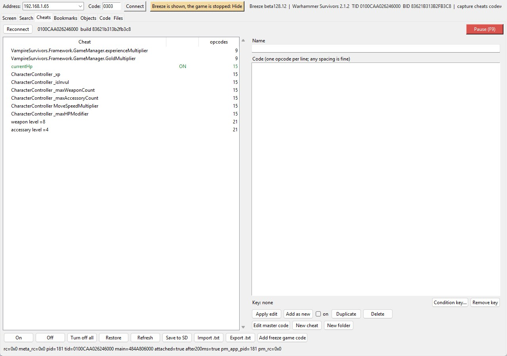
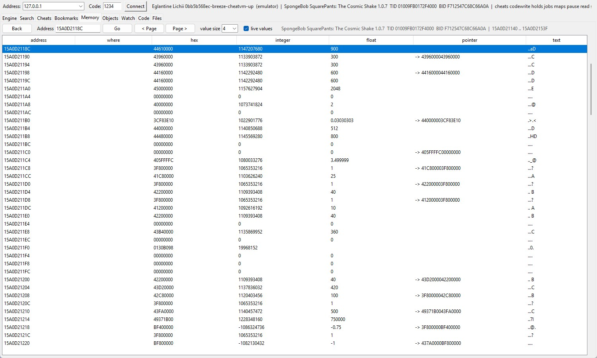
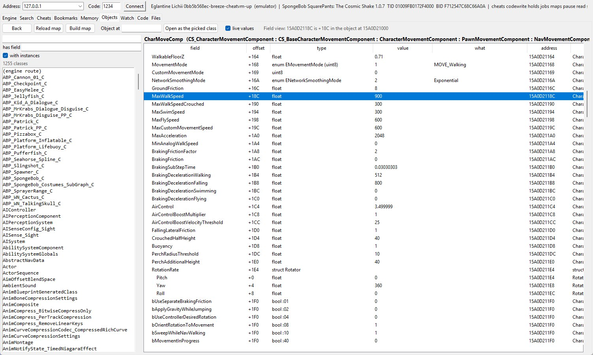
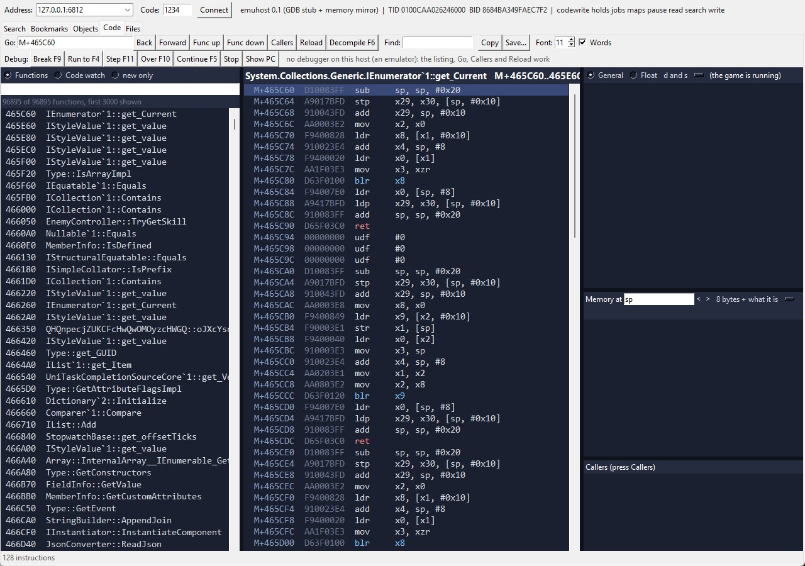
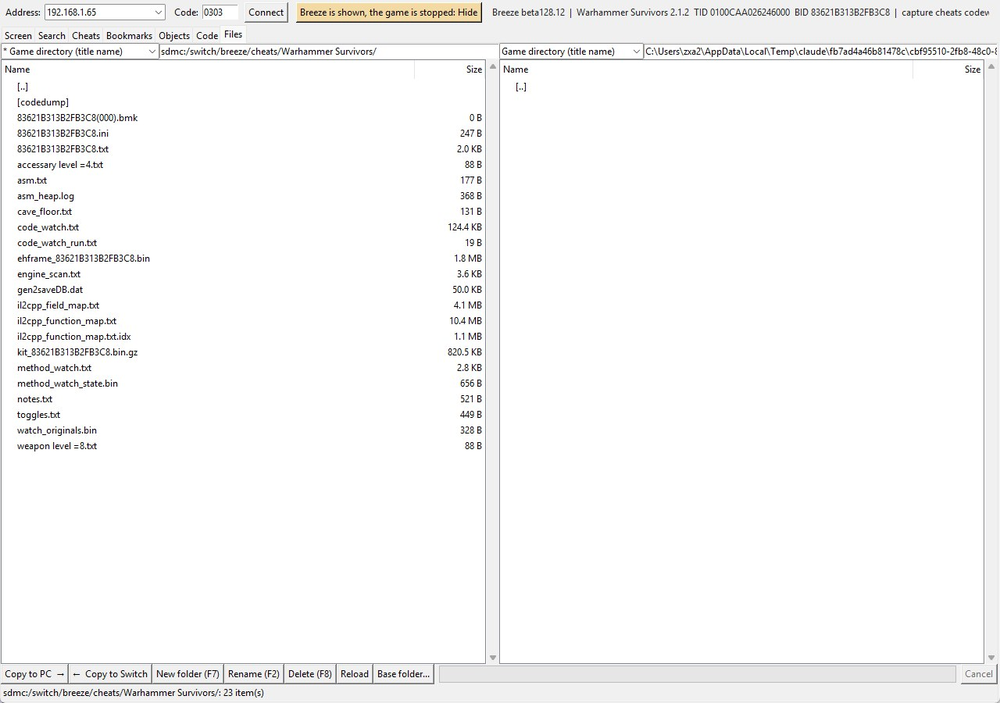
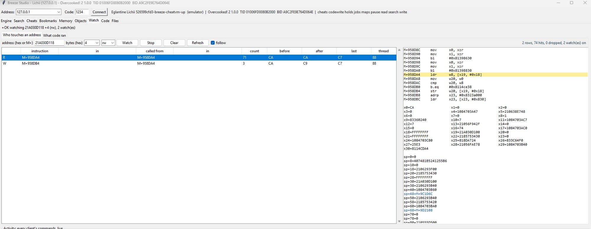

# Breeze Studio Guide

Breeze Studio is Breeze on your PC: one window, with a tab for each kind of work, talking over Wi-Fi to Breeze on the Switch. It is for the times you sit at a PC with the Switch beside you. Breeze's own screen is one of the tabs, so nothing is lost; the other tabs do the same jobs with a mouse, a keyboard and a large window: searching memory, managing cheats, reading the game's objects, finding the code that touches a value.


It comes with Breeze from beta129.00, in `pc_app.zip`, beside the [PC app](pc%20connect%20app.md), which is now Studio's first tab.

## What you need

- Breeze **beta129.00** or later on the Switch, with PC connect on (Settings > **PC connect**; the screen shows the Switch's address and the code).
- The Switch and the PC on the same network.
- **Python 3** on the PC, with Tk (the Windows installer from python.org includes it; on Linux install `python3-tk`).
- The **Pillow** and **capstone** packages: `pip install pillow capstone`. For **Hook here** in the Code tab also **keystone-engine** (`pip install keystone-engine`).
- Everything from `pc_app.zip` in one folder, keeping the `studio` folder beside `breeze_studio.py`.

## Start

Double-click `breeze_studio.bat`, or run:

```
python breeze_studio.py
python breeze_studio.py 192.168.1.65 0303
```

Type the Switch's address and the code at the top and press **Connect**. Both are remembered, with the Switches you used before in the address list.

## The header

- **Address**, **Code**, **Connect**: which Switch. An address may be `ip:port` when the other side is not on port 6801.
- **The Breeze button**: says whether Breeze is in front of the game and switches it. This matters more than it looks: **while Breeze is shown, the game is stopped.** Nothing in the game's memory changes, so a search for "changed" finds nothing and a watch records nothing. Press the button to hide Breeze, do the thing in the game, then come back.
- To its right: Breeze's version, the game, its title id and build id.

A tab connects the first time you open it. Breeze takes six connections at a time; on a Switch the tabs other than Screen let go of theirs when you open another, so you never run out.

## Screen

Breeze's own screen, driven from the PC: this is the [PC app](pc%20connect%20app.md), with everything it has (keyboard and mouse, game input, screenshots, save snapshots, the text view, the cheat source editor). Use it for anything the other tabs do not cover.

## Engine

What the game is built with: Breeze's engine scan as a report. The engine and its version, middleware, the Nintendo SDK, the modules, which Breeze tools fit the game, then every pattern Breeze looked for with its count and first hit. **Scan again** has Breeze redo it; **Copy all** puts the report on the clipboard.

## Search

Breeze's memory search, with any number of searches side by side. Each search is a **target** with a name (the hero's HP, gold, a timer); a target is a candidate file on the SD card, so nothing large crosses the network.


- **New target**: a name, a type, a mode and the value. Every mode of Breeze's search is there, and `none` for a value you do not know yet (a dump of memory to compare later).
- **Queue** several targets and **Start queued**: one pass over memory finds them all.
- Each target's row has its own next step (`++`, `--`, `DIFF`, `SAME`, a value...). **Step** steps one; **Step all** steps every row that has a mode set, in one pass.
- The candidates of the selected target are below, with live values: **Set**, **Inc**, **Revert**, **Hold** / **Unhold**, **Bookmark**, and **Export** to a CSV file.

- **Right-click a candidate** to take it further: **Watch this address** starts "Who touches an address" on it in the Watch tab, **Add to bookmarks**, **Open in Memory**, **Field view** (the object that holds it, in the Objects tab), Hold, Unhold and Copy address.


Hide Breeze before a step that depends on the game having moved on.

These searches are Studio's own: they are kept in `switch/breeze/search/<title id>/` and do not show on Breeze's Search screen.

## Cheats

The cheat list as on Breeze's Cheats screen, with an editor beside it.



- Double-click or Space turns a cheat on or off. **Turn off all** and **Restore** as on Breeze.
- Select a cheat to see its code, one opcode per line. Change the name or the code and **Apply edit**; **Add as new**, **Duplicate**, **Delete**, **New folder**.
- **Condition key...** makes a cheat run only while a button is held; **Add freeze game code** adds Breeze's two freeze cheats.
- **Save to SD** writes the cheat file; **Import .txt** / **Export .txt** read and write a cheat file on the PC.

**What it does.** Under the code box the cheat is written out in words: each opcode, the address it reads or writes in the game right now and what that address holds, and for a write into the game's code the instruction itself (`main+958D5C:  nop   (there now: str s0, [x19, #0x1c])`). Conditions are taken as true and a loop is gone through once, as in Breeze's Trace cheat. Pick a line, then **Jump to target** opens its address in Memory and **Jump to ASM** opens the patched code in Code; double-click does whichever the line has. **Read again** follows an edit of the code box.

## Bookmarks

Values by name, live. On a Switch the tab opens with a view named **Breeze**: the bookmarks of Breeze's own Bookmark screen for this game, read through Breeze.


- Double-click a value to change it. Right-click for **Hold** / **Unhold**, **Make cheat** (adds a cheat, off, that writes the value through the pointer chain), **Copy address**, and **Add to Breeze's bookmarks**.
- **Add bookmark...** adds one by pointer chain.
- **Open file...** loads a game file of your own: named roots, structures and tables of records, described in a small text file (the format is at the top of `studio/studio_bookmarks.py`).

A bookmark you add to Breeze's from the PC shows on Breeze's Bookmark screen too.

## Memory

The game's memory around one address, as Breeze's Memory Explorer shows it: each row is a value with its address, where that is (`main+`, `heap+`), and the value read as hex, integer, float, pointer and text. The values are live.



- Type an address and **Go**; **Back** returns to where you were. The value size is 1, 2, 4 or 8 bytes.
- Double-click a pointer to follow it; double-click any other value to edit it.
- Right-click a row: **Follow pointer**, **Edit value**, **Hold** / **Unhold**, **Who points here** (a list of the places that hold this address), **Watch this address**, **Add to bookmarks**, and **Field view** of the object here or of the object the value points at.

Other tabs open this one: "Open in Memory" on a Search candidate and on an Objects row.

## Objects

For a Unity or an Unreal game: the game's classes and objects, by name, with live values.

The tab reads one file from the game's folder: the field map for a Unity game, the profile for an Unreal one. When it is not there the status line says so: press **Build map** and Breeze makes it, then the tab loads it. For a Unity game on a Switch that takes a few minutes, with the progress in the status line, and Breeze stops the game for the job; the Unreal profile takes seconds. The same button builds a file again, after asking.

On an emulator **Build map** makes the Unity function map too, which is where the Watch tab's function names come from.

**Unity.** It reads the field map (the one Breeze's Main > **Unity** > IL2CPP map builds).


- Left: the classes, filtered as you type. **with statics** keeps the classes that have static fields, which is where a walk through the game's objects starts.
- Pick a class: its static fields with their values now, then its own fields as a layout.
- Double-click a pointer to open the object it points at. Arrays and lists show their elements, a string shows its text. **Back** returns.
- Double-click a number to change it. Right-click: **Hold** / **Unhold**, **Copy chain** (the pointer chain from main), **Add to bookmarks**, **Add to Breeze's bookmarks**.

**Unreal.** It reads the profile (the one Breeze's Main > **Unreal** makes), then the game's own reflection data.

- The list opens on **(engine route)**: GWorld, the game instance, the local player, the player controller, the pawn and its movement component. Double-click one to open it.
- A few seconds later (longer on a Switch) the list has every class. **with instances** keeps the classes that have an object besides their default one. Pick a class: its objects, each with the object it belongs to, then its layout.
- **has field** under the class filter keeps the classes that have a field of that name; the fields of structs inside a class count too. It works for Unity as well.
- Right-click an object > **Find chain to this object**: the pointer chains from main to an object taken from a class's list, which has none of its own. Each chain listed was walked again and reaches the object. On an emulator it takes seconds; on a Switch it has not been tried.
- Right-click a value > **Make cheat...**: the row's chain and a value as cheat code, to copy or to add to the game's cheats, off. A full example: [breeze_studio_cheat_walkthrough.md](./breeze_studio_cheat_walkthrough.md).
- An object shows its properties with its parents', structs in place. A pointer says what it points at, an enum value has its name, a bool is its one bit. Double-click an array or a large struct to open it.
- A row reached from the engine route has a pointer chain from main, for **Copy chain** and the bookmarks. An object picked from a class's list has only its address.

**Field view of an address.** "Field view" on a Search candidate or a Memory row opens the object that holds the address, with the field at it picked. On Unreal it needs the class list to be read first. On Unity it has not been tried yet.



- Right-click a row: **Open in Memory** and **Watch this address** hand the row's address to those tabs.

**Show a field in the rows that point at its object** (Unity). An array or a list of objects shows a column of addresses, which says nothing. Open one of the objects, right-click the field that names it (a name, an id, a count) and pick **Show this field in rows of** > the object's type. From then on every row that points at an object of that type shows that field's value in the **what** column: the list reads as names. The menu also offers the objects you came through on the way, so a value one or two pointers further in can be shown too (an item's data's name). Pick the same entry again to stop showing it. Tick **picked only** to hide the rows that show nothing, which turns a long array into a short list. The picks are the same file as Extract in Breeze's field view (`field_extract.txt` in the game's folder), so what you pick here shows on the Switch, and the other way round.

Not yet: dictionaries (Unity), maps and sets (Unreal), Find chain for Unity, and other engines.

## Watch

Four questions about the running game. All four use the gen2 fork, which runs one watch at a time: starting one ends the one before. The game must be running, so hide Breeze first.

### Who touches an address

Every instruction that reads or writes an address, with the function it is in, who called it and how often. Select a row to see the instructions around it and the return addresses on the stack.


Give the address, the size (1, 2, 4 or 8 bytes), `w`, `r` or `rw`, and how many return addresses to record (**stack**), then **Watch**. The list follows by itself.

### What code ran

A one-time break on every function of the game. **Start**, wait for the count to settle, **Mark**, do one thing in the game: **new** lists the functions that thing called for the first time, with who called each. **classes new** names the classes instead.


The game stutters for the first seconds while the code that runs all the time is found. **Stop** when done: the breaks are in the game's code until then.

### Break and trace

In the Lichii fork only. On a Switch use Breeze's own Gen2 Action menu.

A breakpoint holds the thread that reaches it; the other threads run on, so the picture usually stops while the sound goes on. Set one by typing an address and pressing **Break**, or right-click:

- a row of **Who touches an address**: **Break at this instruction** or **Break at the caller**
- a row of **What code ran**: **Break at this function**
- a line of this panel's code pane or a trace row: **Break here**

While a thread is held the panel shows the code around it, the registers (the ones that changed in red) and the stack.

- **Continue** lets it go. **Step** runs one instruction. **Step over** runs a call to its return.
- **Trace** runs the next instructions (200 unless you say otherwise, 20000 at most) and lists each with its function and the registers it changed. Click a row for the registers at that point. With **over calls** ticked a call counts as one instruction.
- **Set register**: write `x0=1F` (hex) and press the button.

**Clear all** then **Continue** when done.

### Which fields are used

Every byte of one object is watched, and the fields the game reads or writes appear, named, with their values.


Give the object's address and **Start**; for a Unity object the size and the names come from the field map. **Sweep** goes on with only the bytes not seen yet, at full game speed. **Mark**, do one thing in the game: what it touched is highlighted. Double-click a field to carry it to *Who touches an address*.

### Which methods run

Type part of a method name (a class such as `PlayerStats::`, a namespace, or a word such as `Damage`) and **Start**. Each method is listed as called or not, with its first caller and **this**: the object it ran on.


That object is a live instance of the class, found with no search: right-click, **Watch this object's fields**.

## Code

The disassembler and the debugger of the [PC app](pc%20connect%20app.md#the-disassembler): the function list, a whole function at a time, callers, the C view, breakpoints, stepping, registers.



**Memory used** (also on the right-click menu) opens the Memory tab at the address the current line's instruction reads or writes. A fixed address works at once. One that goes through registers, such as `[x19, #0x18]`, uses the registers of the stopped game; on the Lichii fork with the game running it catches them the next time the line runs, and the game goes on.

**Instruction watch** (F8 on a line, or the pane under the listing): which addresses an instruction uses each time it runs. The register and the offset are read off the instruction (`ldr w8, [x19, #0x30]` watches x19+0x30); each row is an address with its hit count and what it holds now. Right-click a row to open it in Memory, to watch who touches it, or to break at the instruction for that value only. On a Switch this is gen2's instruction watch; on the Lichii fork the tab runs it from the PC. In the Watch tab, `x0` to `x30` in the mode box of *Who touches an address* starts one too.

**Hook here** (right-click a line): make an ASM cheat at that instruction. A script editor opens with the usual cave: your code, then `{original}` (the instruction the hook replaces), then `b code1+4`. Its first lines say which registers your code may use without saving them, and whether the flags (`cmp`, `tst`...) may change: the game writes those registers before it reads them, or does not read them before the next call or return. **Check** assembles it on the PC and shows the cave instruction by instruction; **Add cheat** adds it to the game's cheats (off unless **turn it on** is ticked); the Cheats tab saves it. The cave goes in the unused end of the game's code, after the caves the cheats already use; when that room runs out the editor says so, and Breeze's Add ASM on the Switch, which knows more places, is the way. It works on every host: a Switch, the Lichii fork and emuhost.

**Pause** stops the whole game and **Run** lets it go (and lets go a thread held at a breakpoint); they work whichever tab paused it. On the Lichii fork the Debug row works too: breakpoints, Run to, Step, Over, Continue, the registers and the vector registers.

## Files

The PC app's two-panel file manager: the SD card on one side, the PC on the other.



## Emulators

Studio is not only for a Switch. The same window works with a game running in an emulator on the PC, when something there answers Breeze's PC connect protocol; give `127.0.0.1` (or `127.0.0.1:port`) as the address. Studio asks the other side what it can do and shows only the tabs that apply; there is no Screen tab, because there is no Breeze screen. [PC Connect](pcconnect.md#other-hosts-emulators) describes the two kinds of host: an emulator with Breeze's core built in, and `emuhost`, a small program that runs beside an unmodified emulator of the yuzu family and uses its GDB stub.

## Example: freezing the round timer in Overcooked! 2

A whole cheat, from the number on the screen to the code that counts it. Overcooked! 2 1.0.0 (build A9C2FE9E764D064E, Unity), running in the Lichii fork. The steps are the same on a Switch; there gen2 runs one watch at a time and the game only runs while Breeze is hidden.

1. **Build the maps.** Objects > **Build map**. On Overcooked! 2 it took 1.5 s and named 20,142 methods. Without it the next steps show addresses with no names.

2. **Find the number.** Search: the seconds left as a 4-byte value, let the clock move, search the new value, until a few candidates are left. Right-click one > **Watch this address**.

3. **See who touches it.** Watch > Who touches an address now lists one instruction that reads the value and one that writes it, both in `ClientRoundTimer::Update`:

   

   The code pane shows why this address is not the one to change: the write at M+958DB4 stores `w20`, and `w20` is the result of the two calls above it, `Mathf::Max` and `Mathf::CeilToInt`. The address only holds the number last shown.

4. **Find where the number comes from.** Objects > class `ClientRoundTimer` has three fields in a row: `m_timeLeft` +0x18 (the watched address), `m_roundTimer` +0x1C and `m_timeLimit` +0x20, both float. Right-click the watch row > **Copy instruction address**, paste it into Code > **Go**, and read up from there:

   ```
   M+958D54  bl    TimeManager::GetDeltaTime
   M+958D58  fadd  s0, s8, s0
   M+958D5C  str   s0, [x19, #0x1c]      ; m_roundTimer += the frame's time
   ...
   M+958D84  fsub  s0, s9, s8            ; m_timeLimit - m_roundTimer
   M+958D94  bl    UnityEngine.Mathf::Max
   M+958DA0  bl    UnityEngine.Mathf::CeilToInt
   M+958DB4  str   w20, [x19, #0x18]     ; m_timeLeft, for the display
   ```

   The clock is the elapsed time in `m_roundTimer`; the one instruction that moves it is the `str` at M+958D5C. To check a guess like this on the Lichii fork, right-click that line > **Breakpoint here**, then **Step** over it and watch `m_roundTimer` change (**Memory used** opens it).

5. **Look for a twin.** The function list also has `ServerRoundTimer::Update`, the timer that ends the round. It has the same three fields 8 bytes lower and the same store, at M+A36C64. A cheat that stops only the client's clock would show a frozen time and still end the round.

6. **Write the cheat.** A no-op (`D503201F`) over each store. Cheats > **New cheat**, name it, and type:

   ```
   04000000 00958D5C D503201F
   04000000 00A36C64 D503201F
   ```

   The pane under the code says what it will do before it is turned on: `main+958D5C:  nop   (there now: str s0, [x19, #0x1c])`. **Add as new**, turn it on, **Save to SD**.

7. **Give it a way back.** Turning a cheat off stops the writes; it does not put the old instructions back. A second cheat does, with the words the pane showed as "there now":

   ```
   [Round timer runs again (turn Freeze off first)]
   04000000 00958D5C BD001E60
   04000000 00A36C64 BD001660
   ```

   Turn it on for a moment, then off. Left on, it rewrites the instruction on every pass, and a breakpoint or a watch break on that instruction is wiped within a frame.

Checked in this run: both instructions read back as the no-op with the cheat on and as the originals after the second cheat. The game was paused at the time, so the clock standing still in play was not watched.

## Good to know

- **A search finds nothing changed**, or a watch stays empty: Breeze is shown, so the game is stopped. Use the header's button.
- **A tab says it cannot connect** right after another was closed: it tries once more by itself; if not, open it again.
- **Objects is empty**: its status line says what is missing; **Build map** makes it.
- **"wrong code"** with the right code: another server answered. An emulator's own PC connect and a Breeze running inside that emulator are two servers with two ports and two codes; type the address as the one you want shows it, `ip:port`.
- **The Code tab's list is empty for a while**: it is reading the game's function list, once per game.
- Closing Studio leaves the game and Breeze as they are. A watch you started keeps running until you stop it.

## Numbers from one run

Warhammer Survivors 2.1.2 on a Switch, the game running:

| what | time |
|---|---|
| First search, `u32 == 100` (31,155 candidates) | 16 s |
| A next step | 0.6 s |
| Two targets in one pass | 46 s |
| A dump for an unknown value | 107 s |
| `DIFF` after the dump (17 million changed) | 81 s |
| Opening a class in Objects | 0.02 s |
| Code watch: arming 96,166 functions | 2.1 s |
