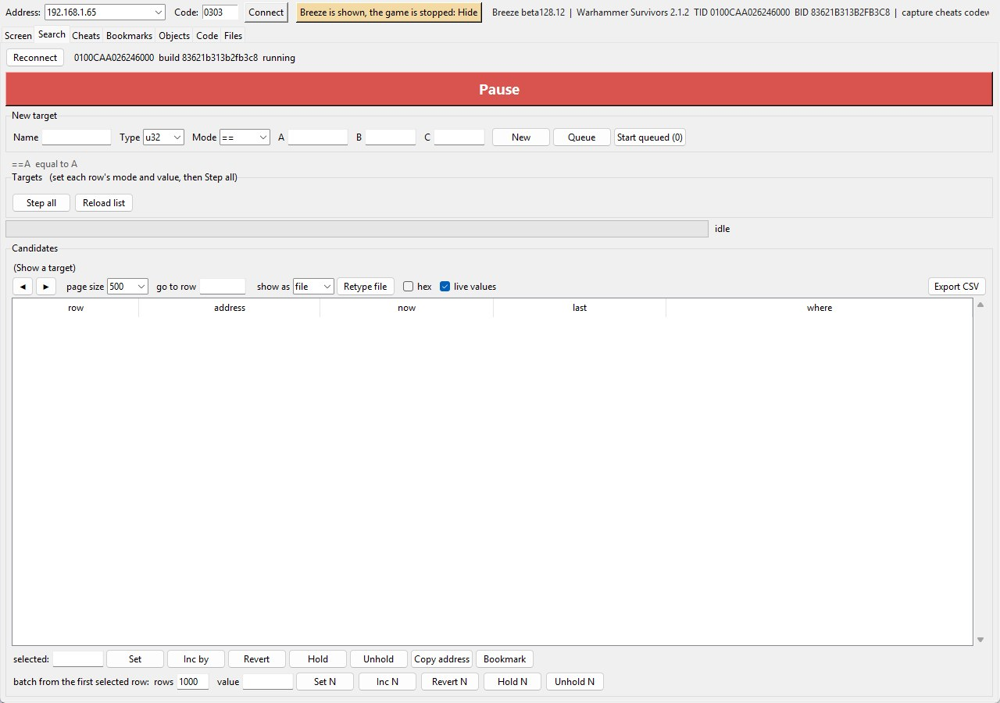
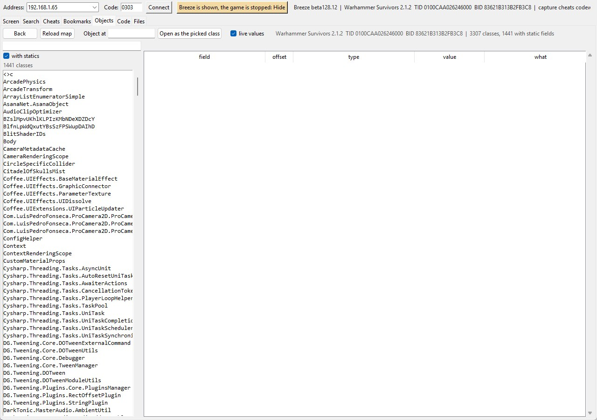
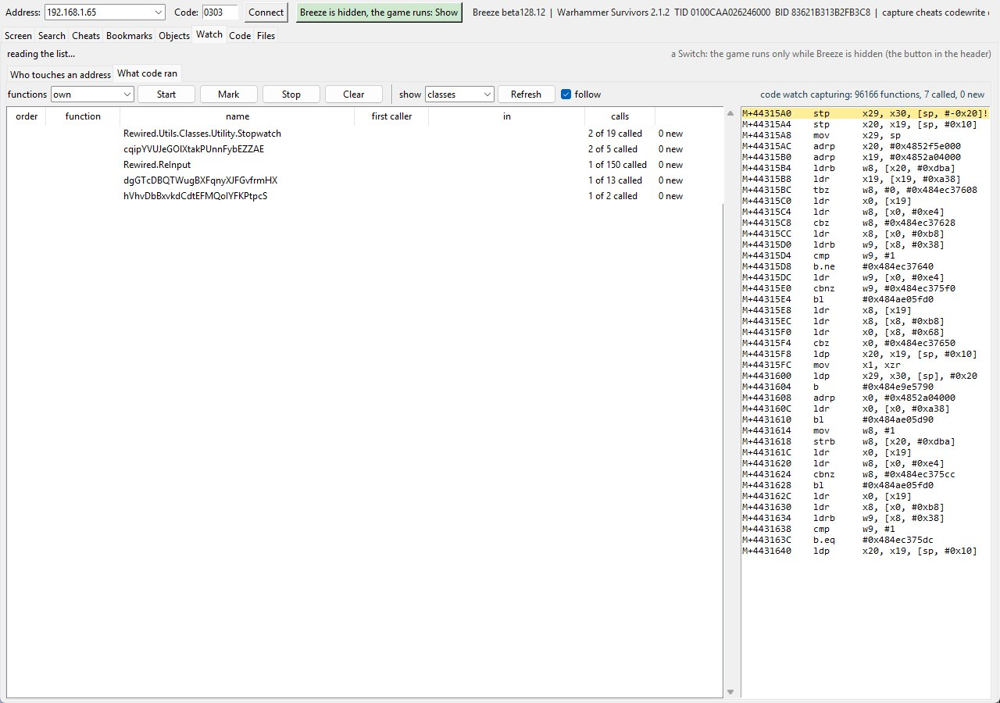
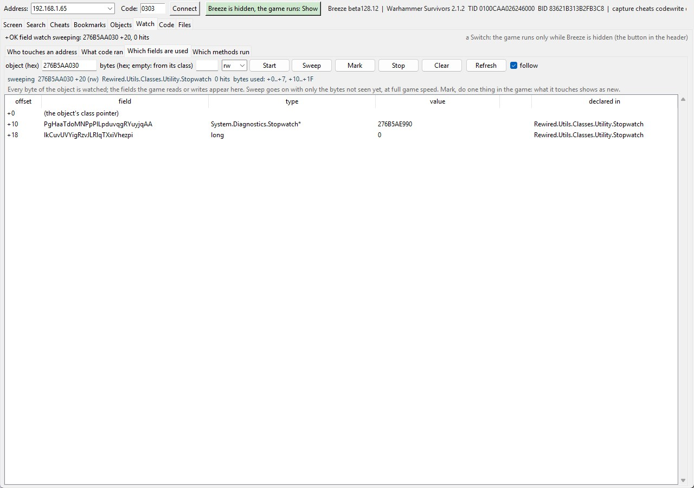
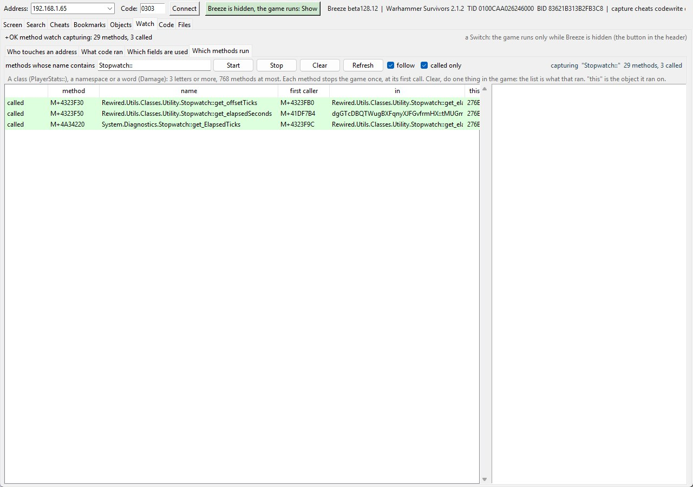

# Breeze Studio Guide

Breeze Studio is Breeze on your PC: one window, with a tab for each kind of work, talking over Wi-Fi to Breeze on the Switch. It is for the times you sit at a PC with the Switch beside you. Breeze's own screen is one of the tabs, so nothing is lost; the other tabs do the same jobs with a mouse, a keyboard and a large window: searching memory, managing cheats, reading the game's objects, finding the code that touches a value.


It comes with Breeze from beta129.00, in `pc_app.zip`, beside the [PC app](pc%20connect%20app.md), which is now Studio's first tab.

## What you need

- Breeze **beta129.00** or later on the Switch, with PC connect on (Settings > **PC connect**; the screen shows the Switch's address and the code).
- The Switch and the PC on the same network.
- **Python 3** on the PC, with Tk (the Windows installer from python.org includes it; on Linux install `python3-tk`).
- The **Pillow** and **capstone** packages: `pip install pillow capstone`.
- Everything from `pc_app.zip` in one folder, keeping the `studio` folder beside `breeze_studio.py`.

## Start

Double-click `breeze_studio.bat`, or run:

```
python breeze_studio.py
python breeze_studio.py 192.168.1.65 0303
```

Type the Switch's address and the code at the top and press **Connect**. Both are remembered, with the Switches you used before in the address list.

## The header

- **Address**, **Code**, **Connect**: which Switch. An address may be `ip:port` when the other side is not on port 6801.
- **The Breeze button**: says whether Breeze is in front of the game and switches it. This matters more than it looks: **while Breeze is shown, the game is stopped.** Nothing in the game's memory changes, so a search for "changed" finds nothing and a watch records nothing. Press the button to hide Breeze, do the thing in the game, then come back.
- To its right: Breeze's version, the game, its title id and build id.

A tab connects the first time you open it. Breeze takes six connections at a time; on a Switch the tabs other than Screen let go of theirs when you open another, so you never run out.

## Screen

Breeze's own screen, driven from the PC: this is the [PC app](pc%20connect%20app.md), with everything it has (keyboard and mouse, game input, screenshots, save snapshots, the text view, the cheat source editor). Use it for anything the other tabs do not cover.

## Search

Breeze's memory search, with any number of searches side by side. Each search is a **target** with a name (the hero's HP, gold, a timer); a target is a candidate file on the SD card, so nothing large crosses the network.



- **New target**: a name, a type, a mode and the value. Every mode of Breeze's search is there, and `none` for a value you do not know yet (a dump of memory to compare later).
- **Queue** several targets and **Start queued**: one pass over memory finds them all.
- Each target's row has its own next step (`++`, `--`, `DIFF`, `SAME`, a value...). **Step** steps one; **Step all** steps every row that has a mode set, in one pass.
- The candidates of the selected target are below, with live values: **Set**, **Inc**, **Revert**, **Hold** / **Unhold**, **Bookmark**, and **Export** to a CSV file.

Hide Breeze before a step that depends on the game having moved on.

These searches are Studio's own: they are kept in `switch/breeze/search/<title id>/` and do not show on Breeze's Search screen.

## Cheats

The cheat list as on Breeze's Cheats screen, with an editor beside it.


- Double-click or Space turns a cheat on or off. **Turn off all** and **Restore** as on Breeze.
- Select a cheat to see its code, one opcode per line. Change the name or the code and **Apply edit**; **Add as new**, **Duplicate**, **Delete**, **New folder**.
- **Condition key...** makes a cheat run only while a button is held; **Add freeze game code** adds Breeze's two freeze cheats.
- **Save to SD** writes the cheat file; **Import .txt** / **Export .txt** read and write a cheat file on the PC.

## Bookmarks

Values by name, live. On a Switch the tab opens with a view named **Breeze**: the bookmarks of Breeze's own Bookmark screen for this game, read through Breeze.


- Double-click a value to change it. Right-click for **Hold** / **Unhold**, **Make cheat** (adds a cheat, off, that writes the value through the pointer chain), **Copy address**, and **Add to Breeze's bookmarks**.
- **Add bookmark...** adds one by pointer chain.
- **Open file...** loads a game file of your own: named roots, structures and tables of records, described in a small text file (the format is at the top of `studio/studio_bookmarks.py`).

A bookmark you add to Breeze's from the PC shows on Breeze's Bookmark screen too.

## Objects

For a Unity game: the game's classes and objects, by name, with live values. It reads the field map Breeze builds (Main > **Unity** > IL2CPP map), so build that once for the game first.



- Left: the classes, filtered as you type. **with statics** keeps the classes that have static fields, which is where a walk through the game's objects starts.
- Pick a class: its static fields with their values now, then its own fields as a layout.
- Double-click a pointer to open the object it points at. Arrays and lists show their elements, a string shows its text. **Back** returns.
- Double-click a number to change it. Right-click: **Hold** / **Unhold**, **Copy chain** (the pointer chain from main), **Add to bookmarks**, **Add to Breeze's bookmarks**.

Not yet: dictionaries, and games that are not Unity.

## Watch

Four questions about the running game. All four use the gen2 fork, which runs one watch at a time: starting one ends the one before. The game must be running, so hide Breeze first.

### Who touches an address

Every instruction that reads or writes an address, with the function it is in, who called it and how often. Select a row to see the instructions around it and the return addresses on the stack.


Give the address, the size (1, 2, 4 or 8 bytes), `w`, `r` or `rw`, and how many return addresses to record (**stack**), then **Watch**. The list follows by itself.

### What code ran

A one-time break on every function of the game. **Start**, wait for the count to settle, **Mark**, do one thing in the game: **new** lists the functions that thing called for the first time, with who called each. **classes new** names the classes instead.



The game stutters for the first seconds while the code that runs all the time is found. **Stop** when done: the breaks are in the game's code until then.

### Which fields are used

Every byte of one object is watched, and the fields the game reads or writes appear, named, with their values.



Give the object's address and **Start**; for a Unity object the size and the names come from the field map. **Sweep** goes on with only the bytes not seen yet, at full game speed. **Mark**, do one thing in the game: what it touched is highlighted. Double-click a field to carry it to *Who touches an address*.

### Which methods run

Type part of a method name (a class such as `PlayerStats::`, a namespace, or a word such as `Damage`) and **Start**. Each method is listed as called or not, with its first caller and **this**: the object it ran on.



That object is a live instance of the class, found with no search: right-click, **Watch this object's fields**.

## Code

The disassembler and the debugger of the [PC app](pc%20connect%20app.md#the-disassembler): the function list, a whole function at a time, callers, the C view, breakpoints, stepping, registers.


## Files

The PC app's two-panel file manager: the SD card on one side, the PC on the other.


## Emulators

Studio is not only for a Switch. The same window works with a game running in an emulator on the PC, when something there answers Breeze's PC connect protocol; give `127.0.0.1` (or `127.0.0.1:port`) as the address. Studio asks the other side what it can do and shows only the tabs that apply; there is no Screen tab, because there is no Breeze screen. [PC Connect](pcconnect.md#other-hosts-emulators) describes the two kinds of host: an emulator with Breeze's core built in, and `emuhost`, a small program that runs beside an unmodified emulator of the yuzu family and uses its GDB stub.

## Good to know

- **A search finds nothing changed**, or a watch stays empty: Breeze is shown, so the game is stopped. Use the header's button.
- **A tab says it cannot connect** right after another was closed: it tries once more by itself; if not, open it again.
- **Objects is empty**: the game has no field map yet. Build it on Breeze (Main > Unity > IL2CPP map).
- **The Code tab's list is empty for a while**: it is reading the game's function list, once per game.
- Closing Studio leaves the game and Breeze as they are. A watch you started keeps running until you stop it.

## Numbers from one run

Warhammer Survivors 2.1.2 on a Switch, the game running:

| what | time |
|---|---|
| First search, `u32 == 100` (31,155 candidates) | 16 s |
| A next step | 0.6 s |
| Two targets in one pass | 46 s |
| A dump for an unknown value | 107 s |
| `DIFF` after the dump (17 million changed) | 81 s |
| Opening a class in Objects | 0.02 s |
| Code watch: arming 96,166 functions | 2.1 s |
