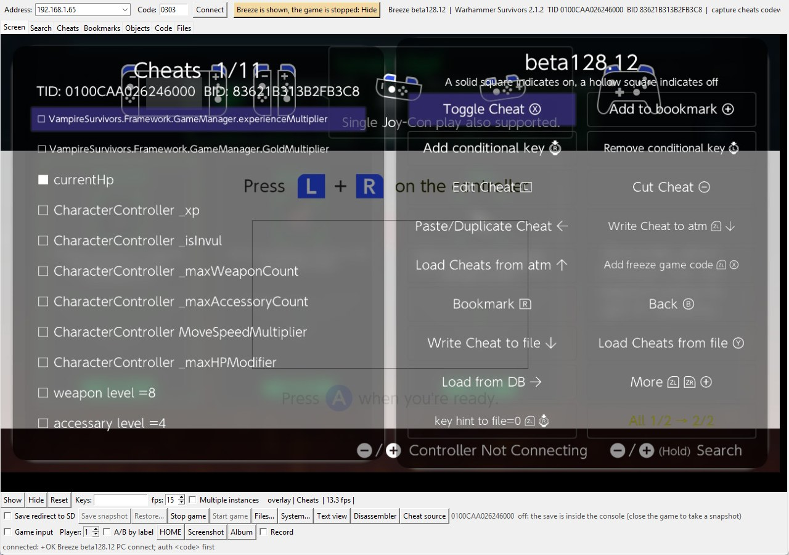
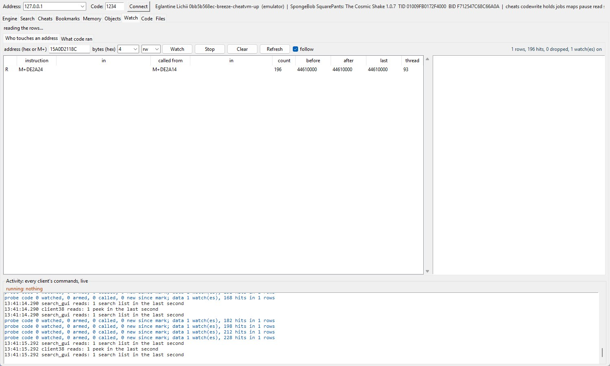
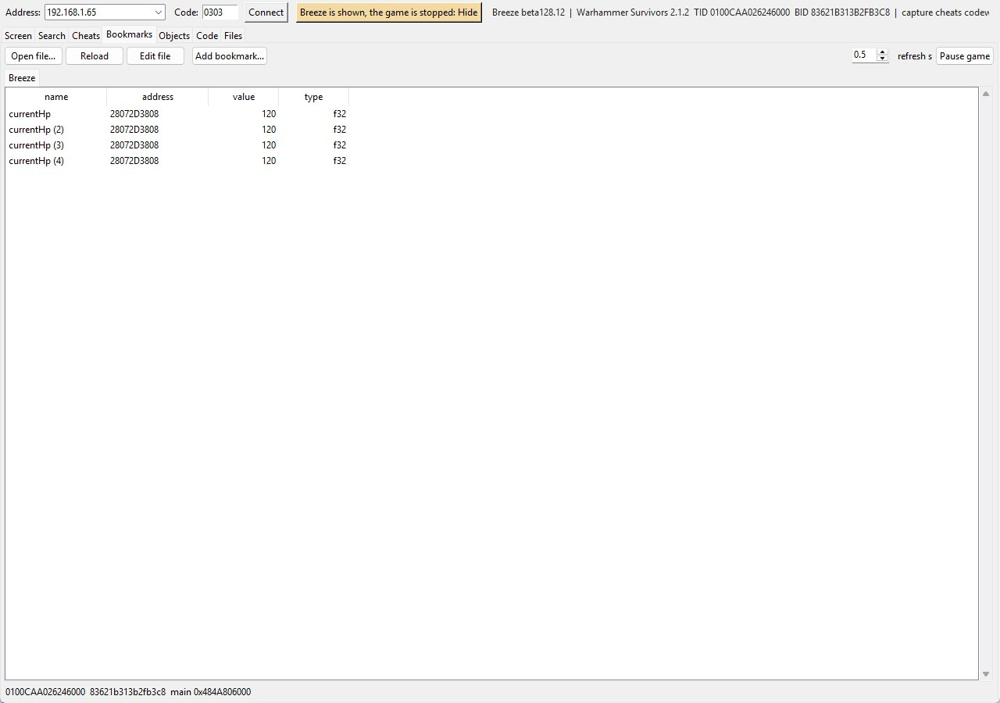
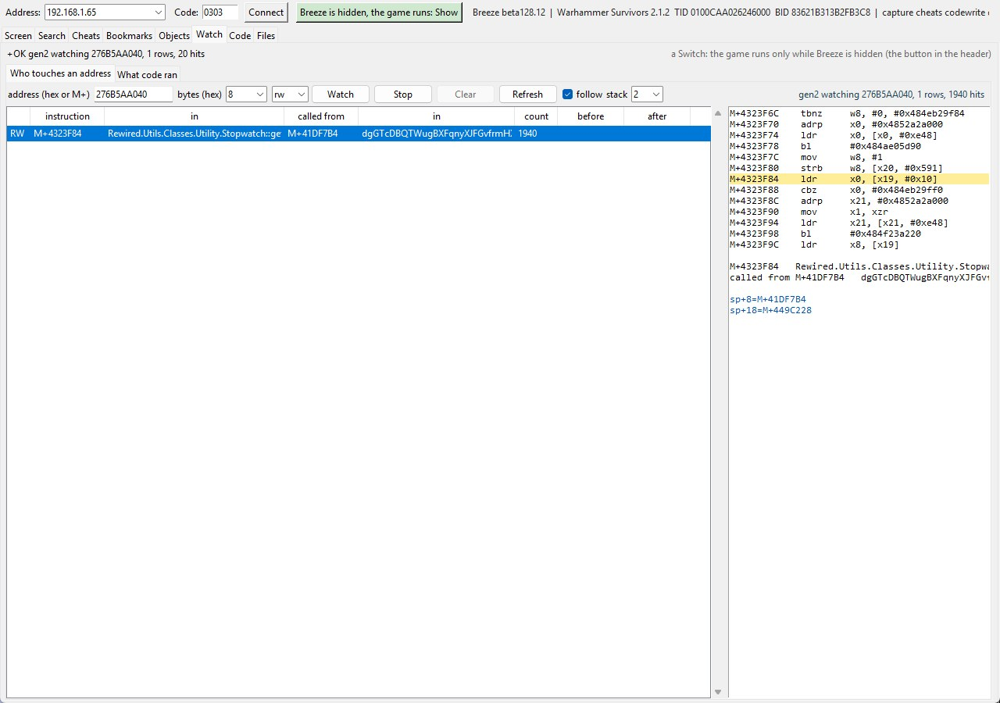

# Breeze Studio Guide

Breeze Studio is Breeze on your PC: one window, with a tab for each kind of work, talking over Wi-Fi to Breeze on the Switch. It is for the times you sit at a PC with the Switch beside you. Breeze's own screen is one of the tabs, so nothing is lost; the other tabs do the same jobs with a mouse, a keyboard and a large window: searching memory, managing cheats, reading the game's objects, finding the code that touches a value.



It is released on its own, from Studio 0.05, at [tomvita/Breeze-Studio](https://github.com/tomvita/Breeze-Studio/releases): `pc_app.zip` has Studio and the [PC app](pc%20connect%20app.md), which is now Studio's first tab, and `pchost_<version>.zip` is for games on the PC. Each Breeze release note names the Studio release to use with it; before 0.05 Studio came with Breeze (beta129.00 to beta129.04).

## What you need

- Breeze **beta129.00** or later on the Switch, with PC connect on (Settings > **PC connect**; the screen shows the Switch's address and the code).
- The Switch and the PC on the same network.
- **Python 3** on the PC, with Tk (the Windows installer from python.org includes it; on Linux install `python3-tk`).
- The **Pillow** and **capstone** packages. The first time Studio starts without them it lists them and installs them if you say Yes (or run `py -m pip install pillow capstone` yourself). For **Hook here** in the Code tab also **keystone-engine** (`py -m pip install keystone-engine`).
- Everything from `pc_app.zip` in one folder, keeping the `studio` folder beside `breeze_studio.py`.

## Start

Double-click `breeze_studio.bat`, or run:

```
python breeze_studio.py
python breeze_studio.py 192.168.1.65 0303
```

Start what Studio talks to, then type its address and code at the top and press **Connect**. Both are remembered, with the ones you used before in the address list. The Start tab says the same:

| You use Studio with | First | Address | Code |
|---|---|---|---|
| a Switch | open Breeze, turn on Settings > **PC connect** (same network as the PC) | the IP Breeze shows | the code Breeze shows |
| the Lichii fork | Configure > Debug > **Enable PC connect**, start a game | `127.0.0.1` | the code shown there |
| another yuzu-family emulator | turn on **Enable GDB stub** in its Debug settings, start the game, then `emuhost.exe` ([Emulators](#emulators)) | `127.0.0.1` | `1234` |
| a game on this PC | start the game, then `pchost.exe` ([PC games](#pc-games-pchost)) | `127.0.0.1` | `1234` |

When Connect fails, the header says why and the Start tab says what to check:

- **nothing answers at ...**: nothing is listening at that address yet. Turn on PC connect in Breeze, start emuhost or pchost, or type `ip:port` if the program uses another port.
- **no answer from ...**: the IP is wrong (it can change after the router or the Switch restarts), the Switch is asleep or Breeze is closed, or the PC and the Switch are on different networks (a guest network, a VPN or a firewall).
- **wrong code**: the code is wrong; the message says where the right one is shown.

## The header

- **Address**, **Code**, **Connect**: which Switch. An address may be `ip:port` when the other side is not on port 6801.
- **The Breeze button**: says whether Breeze is in front of the game and switches it. This matters more than it looks: **while Breeze is shown, the game is stopped.** Nothing in the game's memory changes, so a search for "changed" finds nothing and a watch records nothing. Press the button to hide Breeze, do the thing in the game, then come back.
- To its right: Breeze's version, the game, its title id and build id. The window's title says the same, with Studio's own version first.
- **Fit**, at the right end: the window as small as it can be with everything in the tab shown. Every table's columns become as wide as their widest text and the table as tall as its rows, every list as wide as its longest line, and the bar between side-by-side parts moves to where the left part ends. When the rows are more than the screen holds, the window takes the screen's height and the tallest list gives up rows first. A table that fills later (a new search, another object) is not refitted: press Fit again. A tab in a window of its own: right-click a tab > **Fit the ... window**.
- **On top**: Studio's window and its detached tabs stay above other programs, so a PC game in front does not cover them. It is remembered.
- **rows**, beside Fit: the most rows Fit gives any one table or list (30 at first), so one long list, such as Objects' classes or Memory's rows, does not take the whole height from the rest. It applies to the windows Beside opens too.
- **Beside** (on at first): when one tab sends you to another (Open in Memory, Field view, Jump to target, Open in Code...), that tab opens as a window of its own next to the window you were in, fitted to what it shows, instead of taking that tab's place. It goes to the right if the screen has room, else to the left. The next action of the same kind reuses that window, without moving it. Clicking a tab still switches tabs as before. Turn Beside off for the old behaviour; on a Switch each window keeps a connection of its own.
- **Mouse back and forward buttons**: over Memory, Objects or Code, they step back to the view before and forward again, the same as Back in those tabs. Opening something new drops the views you went back from.

A tab connects the first time you open it. Breeze takes six connections at a time; on a Switch the tabs other than Screen let go of theirs when you open another, so you never run out.

### Changing a value

Changing a value in Memory, Workbench, Objects or Bookmarks, or a cheat line's value in Cheats, opens one pop-up: the value now in four boxes, **Decimal** (signed), **Hex**, **Float 32** and **Float 64**. Type in any of them and the others follow, so you see at once what 1.5 is in hex, or what a hex word is as a float. **OK** writes the bytes the boxes show, as wide as the value. On an 8-byte value Float 32 is the low 4 bytes (typing there keeps the high 4); on a 4-byte value Float 64 is off, and on 1 or 2 bytes both floats are. A Bookmarks field with names (`enum`) still takes a name typed in.

## Screen

Breeze's own screen, driven from the PC: this is the [PC app](pc%20connect%20app.md), with everything it has (keyboard and mouse, game input, screenshots, save snapshots, the text view, the cheat source editor). Use it for anything the other tabs do not cover.

## Engine

What the game is built with: Breeze's engine scan as a report. The engine and its version, middleware, the Nintendo SDK, the modules, which Breeze tools fit the game, then every pattern Breeze looked for with its count and first hit. **Scan again** has Breeze redo it; **Copy all** puts the report on the clipboard.

## Search

Breeze's memory search, with any number of searches side by side. Each search is a **target** with a name (the hero's HP, gold, a timer); a target is a candidate file on the SD card, so nothing large crosses the network.


- **New target**: a name, a type, a mode and the value. Every mode of Breeze's search is there, by the names Breeze's Search screen uses (`[A..B]`, `<A..B>`, `[A,B]`, `SAME` ...), and `unknown` for a value you do not know yet (a dump of memory to compare later).
- **Queue** several targets and **Start queued**: one pass over memory finds them all.
- Each target's row has its own next step (`++`, `--`, `DIFF`, `SAME`, a value...). **Step** steps one; **Step all** steps every row that has a mode set, in one pass.
- The candidates of the selected target are below, with live values: **Set**, **Inc**, **Revert**, **Hold** / **Unhold**, **Bookmark**, and **Export** to a CSV file.
- The **label** column names the field a candidate sits on: `TextTween+20 target` is field `target` at +0x20 of a `TextTween`. It is the field Objects' **Field view** would pick (Unity: the IL2CPP map, or the class in memory; Unreal: the profile), or a label you gave the field (`sPlayer+20 coins`, see [Names for a game Studio does not know](#names-for-a-game-studio-does-not-know)), which wins. An array element reads `Entry<int, int>[]+2C [0].value` (element 0 of a dictionary's entries, its value). Empty: no known object holds the address. Labels come in a moment after the rows, on a connection of their own.

- **Right-click a candidate** to take it further: **Watch this address** starts "Who touches an address" on it in the Watch tab, **Add to bookmarks**, **Open in Memory**, **Field view** (the object that holds it, in the Objects tab), Hold, Unhold and Copy address.



Hide Breeze before a step that depends on the game having moved on.

These searches are Studio's own: they are kept in `switch/breeze/search/<title id>/` and do not show on Breeze's Search screen.

## Cheats

The cheat list as on Breeze's Cheats screen, with an editor beside it.


- Double-click or Space turns a cheat on or off. **Turn off all** and **Restore** as on Breeze.
- Select a cheat to see its code, one opcode per line. Change the name or the code and **Apply edit**; **Add as new**, **Duplicate**, **Delete**, **New folder**.
- **Double-click the value** of a code line (or right-click the line > **Edit value of this line...**) to change it in the value pop-up (see [Changing a value](#changing-a-value)). The opcode decides which words are the value and how wide it is, as the cheat VM reads them: in `400E0000 00000000 00002710` the last two words are an 8-byte value (10000); in `04000000 00123456 0000270F` the last word is a 4-byte one; `6T..`, `7T..`, `9T..` with a value, `C0T..4..` and a loop's count work the same way. Typing 1.5 in Float 32 on `400E...` gives `400E0000 00000000 3FC00000`. The line is rewritten; **Apply edit** keeps it.
- **Condition key...** makes a cheat run only while a button is held; **Add freeze game code** adds Breeze's two freeze cheats.
- **Save to SD** writes the cheat file and **Load from SD** reads it again; **Import .txt** / **Export .txt** read and write a cheat file on the PC. Export adds a "<name> - restore" cheat after each code-patch cheat, for people whose cheat tool cannot put the game's code back.
- **Make cheat** makes a cheat from one of the game's recipes, as Breeze's Cheats > Make cheat does (`make_cheat.ini` in the game's folder, the format in [make cheat recipes.md](./make%20cheat%20recipes.md)). Pick rows of the recipe's table (items, for example), fill in the values it asks for and the key, and the cheat is added on, replacing one of the same name, and saved to SD. A recipe that holds addresses must name this build; the cheat it `requires` must be in the list already (it is turned on when it is off).
- The list shows each cheat's number (the one PC connect's `cheats on 7` takes) and its **kind**: ASM (a hook with a cave), patch (a code patch that keeps the game's instructions), code, pointer or value, with ", key" when a button gates it.
- **Off** and **Turn off all** put a code-patch cheat's original instructions back, in one step (Breeze does it on the second press of a green cheat).
- **Merge into...** moves the selected cheat's patches into another cheat, as Breeze's Merge into: one cheat that patches many places and keeps the game's instructions. Naming the cheat itself converts an older patch cheat (and its "- restore" cheat) into this kind.

**What it does.** Under the code box the cheat is written out in words: each opcode, the address it reads or writes in the game right now and what that address holds, and for a write into the game's code the instruction itself (`main+958D5C:  nop   (there now: str s0, [x19, #0x1c])`). An ASM cheat gets a line above saying so (`ASM hook at main+5B5BE50, branching to a cave at main+9ADFD40 (107 instructions ...)`), each 8-byte cave line shows its two instructions, and branch targets read `main+X`. Conditions are taken as true and a loop is gone through once, as in Breeze's Trace cheat. A key condition reads as the buttons it waits for, held or once a press (both the old `8` form and Breeze's `C4`). Pick a line, then **Jump to target** opens its address in Memory and **Jump to ASM** opens the patched code in Code; double-click does whichever the line has. With no line picked, Jump to target takes the cheat's last address (the value it writes). A pointer cheat's chain goes with it (`580F...` loads, `780F` / `9...` adds, `400E` values are followed), so Memory opens on the chain, e.g. `main+44298C0 › +B8 › +0 › +30 › +208 › +20`, and ◀ walks back along it. **Read again** follows an edit of the code box.

## Bookmarks

Values by name, live. On a Switch the tab opens with a view named **Breeze**: the bookmarks of Breeze's own Bookmark screen for this game, read through Breeze.



- Double-click a value to change it. Right-click for **Hold** / **Unhold**, **Make cheat** (adds a cheat, off, that writes the value through the pointer chain), **Copy address**, and **Add to Breeze's bookmarks**.
- **Add bookmark...** adds one by pointer chain.
- **Open file...** loads a game file of your own: named roots, structures and tables of records, described in a small text file (the format is at the top of `studio/studio_bookmarks.py`).

A bookmark you add to Breeze's from the PC shows on Breeze's Bookmark screen too.

## Memory

The game's memory as Breeze's Memory Explorer shows it: a pointer chain, and the memory where it lands, one detected value per row. The values are live.


**The chain.** The line at the top reads like a Breeze bookmark: `main+4468F70 › +B8 › +0 › +10 › +18 › +2C` reads the pointer at main+4468F70, then the one at that + B8, and so on, and lands at the last one + 2C. The step the cursor is on is highlighted; after it, greyed, the steps you came back from. Beside it: the depth (`z=`), the cursor's address and its field.
- Picking a row moves the highlighted step's offset onto it, as Breeze's cursor does (the greyed steps stay).
- Double-click (or Enter, or Right) on a pointer to **follow** it: one more step. **◀** or Left goes one step back, the cursor on the pointer this step was read from; **▶** or Right goes forward again along the greyed steps. Click any step to go to it.
- **▲ Page** / **▼ Page** (Page Up / Page Down) move the cursor a page, as on Breeze, so it stays on screen.
- **Field view**: when the cursor is in an object Studio knows (Unity, Unreal), the page is that object, from its start to its end, each row a field with its name and type (an array: its elements, `[0].value`); the status line names it. Moving out of it (a page, a step elsewhere) shows plain memory again; **field view** off keeps plain memory.
- Each read resolves the chain again, so the view follows an object the game moves. A step that no longer points anywhere is shown red.
- "Open in Memory" from Bookmarks, from an Objects row (Find chain's rows too) and from a pointer scan's chain keeps the chain; from a Search candidate it starts at the address (or main+ inside main). Type a chain in **Address** too: `[[main+4468F70]+B8]+10`, or a pointer scan's `main+4468F70 B8 +10`. **Back** returns to where the view was before the last go-to; **Copy chain** copies the picked row's chain.

**Smart display.** Each row is one value whose type is detected, shown in the type column: `ptr` (the value says where it points: `main+`, a field, a named object), `f32`, `f64`, `s32`, `text`, `fixed` (32.32, Breeze's Fp), `hex32` when nothing matched. On Unity and Unreal the where column names the field (`Dictionary`2<int, int>+18 _entries`, read in the background by the Objects tab's reader) and the field's own type is used before any guess (an enum: as wide as the field). **smart** off shows plain hex words where no field is known; known fields keep their type.
- **Detection...**: the detectors in order, top first (the first that matches a value wins); each can be switched off, and has its limits (a float counts from 0.1 to 100000 by default, as on Breeze; a pointer from 10000; an integer up to 100000; text from 4 characters). **Up** / **Down** set the order; **Apply and save** keeps them for every game.
- Right-click > **Show as**: one value's type by hand (`*` after the type marks it); **auto** gives it back to the detectors. It is kept per game relative to the object it is in, so it holds when the object moves.

**Right-click a row:** **Follow pointer**, **Edit value** (the decimal / hex / float pop-up, as wide as the value), **Show as**, **Hold** / **Unhold**, **Make cheat...** (the chain from main, then a store of the value you set: Copy, or add it to the game's cheats, off), **Add to bookmarks...** (Studio's Bookmarks tab, with the chain), **Add to Breeze's bookmarks...** (Breeze's own file, through Breeze), **Copy chain**, **Who points here** (a list of the places that hold this address), **Find pointer chains to here**, **Field view of what it points at**, and the address menu every tab shares (see [Workbench](#workbench)). Make cheat and Breeze's bookmarks need a chain from main (or a region): on a plain address, find a chain first.

### Pointer chains to a value

A value you found moves when the game restarts. A cheat reaches it through a **pointer chain** from the game's main module: read a pointer there, add an offset, read the next pointer, and so on. Right-click the value's row > **Find pointer chains to here** and Studio lists the chains to it in the **Pointers** tab (emulator hosts and PC games). The tab keeps every scan per game: after Studio is restarted, open it and the last scan is there.

- Set **depth** (how many pointers deep), **max offset** (how far a field may be from the start of its object) and **chains** (how many to keep), then **Scan**. The defaults (4, 800, 5000) suit most games. The chains are sorted shortest first before the list is cut, so a small **chains** number drops the long ones first, and the chain the game keeps is often a long one.
- Each chain is written the way a cheat walks it: `main+7182B0 7A8 0 +20` reads the pointer at `main+7182B0`, then the pointer at that + 7A8, then the one at that + 0, and adds 20. Beside it: where it lands now and the value there.
- **Which chain is the right one** is not decided by length or by small offsets. Restart the game, find the value again, type its new address in the box and press **Keep only chains to here**: the chains that no longer land on it are dropped. After two or three restarts the chains left are the ones the game really uses. The list is kept per game on the PC, so it is still there after Studio is closed. **Find target by chains** saves searching for the value again: type its value (and type, u32 by default) and press it. Studio reads where every chain lands now and puts the place most of them reach that holds the value in the Address box; then press Keep. Empty value: the place most chains reach. **Remove broken** drops the chains that lead nowhere now (a pointer on the way reads no memory) without needing the value's new address. **Auto clear** does the clearing for you: its menu picks what goes (broken chains, chains whose end does not hold the value in the value box, chains that do not land on the Address box; **Clear now** does it once), and with the **auto clear** box ticked it runs every 3 seconds while you play. A clear that would drop every chain is refused and turns auto clear off (the value changed, not every chain). Chains dropped are gone from the saved scan, so untick it before the value changes on purpose; **Undo** puts back the list as it was before the last Keep, Remove broken, clear or Remove from the list (the last 20 changes since Studio started).
- **Make cheat**: pick one or more chains, choose the type and the value, and **Copy** the cheat or **Add to the game's cheats** (added off).
- Double-click a chain to open Memory where it lands.

Fast Fusion in Lichii: the scan read 39 GB of memory in 6.7 s. Of the first two chains chosen by hand, one broke at the next restart; **Keep only chains to here** finds that out for you.

This needs a host that answers `ptrscan`: a game in an emulator (the Lichii fork, or `emuhost`). Breeze on a Switch does not have it yet.

### Names for a game Studio does not know

For Unity, Unreal and C++ games with type information, Studio and Breeze know what each object is. Some games keep a name for every kind of object in memory in their own way. A small file in the game folder, `object_names.txt`, says how to read it:

```
v1
type +0
name [+8] +2 ::
back 800
```

- `type +0`: an object's type pointer is its first 8 bytes.
- `name [+8] +2 ::`: from the type, read the pointer at +8, add 2, and take the text up to `::`.
- `back 800`: an address belongs to an object that starts at most 0x800 bytes before it.

That is Fast Fusion's file: its objects point at a table of names such as `sPlayer::getPlayerName`. With it, Memory's **where** column reads `sPlayer+20` instead of a bare `heap+` address, and a pointer to an object shows the object's class.

- Right-click a row > **Label this field**: give the field a name and a type (`coins`, `u32`). The where column then reads `sPlayer+20 coins`. Labels go to `field_annotations.txt` in the game folder, the file Breeze's field views use, so Breeze's **Class field** shows them too: on a game with `object_names.txt` it opens the object by name (`sPlayer [named]`) with the cursor on your value.
- An object can hold others inside it, each with its own type: Fast Fusion's `sPlayer` holds an `sSeriesResult` from +1C0, so the boost meter at +384 is both `sPlayer+384` and `sSeriesResult+1C4`. The label dialog asks which object the field belongs to, and a labelled field wins from then on.
- The pointer chain list names the object each chain ends in: `? > ? > sPlayer+384 boost`.

## Workbench

One address, followed from its value to the code that changes it: the steps of making a cheat in one place. Open it from any address with **Work on this address**, or type an address (hex or `M+`) and **Go**.

- **Top:** the value, live (hex, integer, float), with **Edit**, **Hold** / **Unhold**, **Bookmark**, and buttons to Memory, Field view and Pointer chains.
- **Left, who reads or writes it:** **Watch** starts a watch on the address (w, r or rw); each row is an instruction that touched it, the function it is in, where it was called from, and how often. It is the Watch tab's watch (gen2 on a Switch, the probe on the Lichii fork, emuhost), so the list is shared with that tab: **Clear** clears both.
- **Right, the instruction:** pick a row on the left to see that instruction with the code around it, then **Open in Code**, **Patch this instruction...** or **Hook here...**.
- **Bottom:** the cheats that write the address or the picked instruction, with the line that does it.

**Right-click any address.** Memory, Objects, Search, Bookmarks and a cheat's *What it does* line share one menu for the address picked: **Work on this address**, **Open in Memory**, **Open in Code**, **Field view (the object here)**, **Watch who reads or writes it**, **Find pointer chains to here**, **Copy address**.

Tried on the Lichii fork (Disney Dreamlight Valley: a frame counter watched to the instruction that adds 1 to it); not yet on a Switch or emuhost.

## Objects

For a Unity or an Unreal game: the game's classes and objects, by name, with live values.

The tab reads one file from the game's folder: the field map for a Unity game, the profile for an Unreal one. When it is not there the status line says so: press **Build map** and Breeze makes it, then the tab loads it. For a Unity game on a Switch that takes a few minutes, with the progress in the status line, and Breeze stops the game for the job; the Unreal profile takes seconds. The same button builds a file again, after asking.

On an emulator **Build map** makes the Unity function map too, which is where the Watch tab's function names come from.

**Unity.** It reads the field map (the one Breeze's Main > **Unity** > IL2CPP map builds).


- Left: the classes, filtered as you type. **with statics** keeps the classes that have static fields, which is where a walk through the game's objects starts.
- Pick a class: its static fields with their values now, then its own fields as a layout.
- Double-click a pointer to open the object it points at. Arrays and lists show their elements, a string shows its text. **Back** returns.
- Double-click a number to change it. Right-click: **Hold** / **Unhold**, **Copy chain** (the pointer chain from main), **Add to bookmarks**, **Add to Breeze's bookmarks**.
- **has field** under the class filter keeps the classes that have a field of that name. Pick one and its matching fields are marked; with **matching only** ticked (the default) the view shows only them. When nothing in the view matches (an object opened from a pointer), every field shows.
- Right-click a value > **Find chain to this object**: the pointer chains from main to that value, for an object that has none of its own (one opened by Field view of an address). On a pointer, the chains to the object it points at. The search starts at every class's static fields and follows fields, arrays, lists and dictionaries whose type can lead to the object's class, as Breeze's Main > Unity > Find chain does. Right-click the chain it finds > **Make cheat...**. On Void Reaver (a PC game) the money's chain took 1.4 s. A value inside an array (a dictionary's entry, a list's item) gets the chains to the object holding the array, then its field: on Land of Glarefall the coins are `BagData.instance > basedata > _entries > [0].value`, `[[[[[main+4468F70]+B8]+0]+10]+18]+2C` (finding the holder takes one scan of memory, 3 s there). An entry's place in a dictionary can change when entries are added or removed.

**Unreal.** It reads the profile (the one Breeze's Main > **Unreal** makes), then the game's own reflection data.

- The list opens on **(engine route)**: GWorld, the game instance, the local player, the player controller, the pawn and its movement component. Double-click one to open it.
- A few seconds later (longer on a Switch) the list has every class. **with instances** keeps the classes that have an object besides their default one. Pick a class: its objects, each with the object it belongs to, then its layout.
- **has field** under the class filter keeps the classes that have a field of that name; the fields of structs inside a class count too. It works for Unity as well.
- Right-click an object > **Find chain to this object**: the pointer chains from main to an object taken from a class's list, which has none of its own. Each chain listed was walked again and reaches the object. On an emulator it takes seconds; on a Switch it has not been tried.
- Right-click a value > **Make cheat...**: the row's chain and a value as cheat code, to copy or to add to the game's cheats, off. A full example: [breeze_studio_cheat_walkthrough.md](./breeze_studio_cheat_walkthrough.md).
- An object shows its properties with its parents', structs in place. A pointer says what it points at, an enum value has its name, a bool is its one bit. Double-click an array or a large struct to open it.
- A row reached from the engine route has a pointer chain from main, for **Copy chain** and the bookmarks. An object picked from a class's list has only its address.

**GAS attributes (Unreal).** Many Unreal games keep the player's stats in the Gameplay Ability System: health, armor, ammo, XP, cooldowns, gold multipliers. **(attributes, GAS)** at the top of the class list shows them all, as Breeze's Main > Unreal > Attributes does.

- It finds the ability system component on the pawn (or its PlayerState, or the player controller), then every attribute set in its SpawnedAttributes. All of it comes from the game's reflection data, by name and by type.
- One row per attribute with its Current value, and in **what** its cap and its Base when that differs. Attributes at 0 are hidden; the last row shows them. Double-click a value to change it: Base and Current are both written, or the game puts the old value back.
- The cap is found by name: `HealthMax`, `MaxHealth`, `CurrentAmmo` to `MaxAmmo`, `HealthPower` to `MaxHealth`. Right-click > **Set the cap of this attribute...** when the name says nothing. That is saved per game in `studio/views/<TID>_gas.txt`.
- **from** says what a cheat on it should do: **fill from cap**, **set**, **multiplier**, **cap** (of another attribute), or **changed by the game** (Current differs from Base and nothing caps it: something in the game changes it, and a cheat would fight that).
- Pick several rows (Ctrl / Shift), right-click > **Make cheats (attributes)...**: one line per attribute with a cheat name, what it does (fill from cap, set, leave out), the value and an **off cheat** that writes back the value read now. A multiplier starts at 10. The code of them all shows below. **Add all to the game's cheats (off)**, then **Try them**: each cheat on for a second and its value read back (a fill cheat after its value is halved), PASS or FAIL, all left off. The Cheats tab's **Save** writes the file.
- The cheats pick a set by its place in SpawnedAttributes. Studio notes the set's class when it adds cheats, and the view's title starts with SET MOVED if another class is there later.
- On Revenge of the Mage (a PC game, UE 5.8): one set, 114 attributes, 49 not 0. Infinite health, armor and a gold x10 with its off cheat made this way all passed Try.

**Field view of an address.** "Field view" on a Search candidate or a Memory row opens the object that holds the address, with the field at it picked. On Unity an address inside an array opens the array with that element's field picked; an element type the map does not name (a dictionary's `Entry<int, int>`) is read from the array's class in memory. On Unreal it needs the class list to be read first.


- Right-click a row: **Open in Memory** and **Watch this address** hand the row's address to those tabs.

**Show a field in the rows that point at its object** (Unity). An array or a list of objects shows a column of addresses, which says nothing. Open one of the objects, right-click the field that names it (a name, an id, a count) and pick **Show this field in rows of** > the object's type. From then on every row that points at an object of that type shows that field's value in the **what** column: the list reads as names. The menu also offers the objects you came through on the way, so a value one or two pointers further in can be shown too (an item's data's name). Pick the same entry again to stop showing it. Tick **picked only** to hide the rows that show nothing, which turns a long array into a short list. The picks are the same file as Extract in Breeze's field view (`field_extract.txt` in the game's folder), so what you pick here shows on the Switch, and the other way round.

Not yet: dictionaries in the Unity view (Find chain walks through them), and other engines.

## Watch

Four questions about the running game. All four use the gen2 fork, which runs one watch at a time: starting one ends the one before. The game must be running, so hide Breeze first.

### Who touches an address

Every instruction that reads or writes an address, with the function it is in, who called it and how often. Select a row to see the instructions around it and the return addresses on the stack.



Give the address, the size (1, 2, 4 or 8 bytes), `w`, `r` or `rw`, and how many return addresses to record (**stack**), then **Watch**. The list follows by itself.

### What code ran

A one-time break on every function of the game. **Start**, wait for the count to settle, **Mark**, do one thing in the game: **new** lists the functions that thing called for the first time, with who called each. **classes new** names the classes instead.


The game stutters for the first seconds while the code that runs all the time is found. **Stop** when done: the breaks are in the game's code until then.

### Break and trace

In the Lichii fork only. On a Switch use Breeze's own Gen2 Action menu.

A breakpoint holds the thread that reaches it; the other threads run on, so the picture usually stops while the sound goes on. Set one by typing an address and pressing **Break**, or right-click:

- a row of **Who touches an address**: **Break at this instruction** or **Break at the caller**
- a row of **What code ran**: **Break at this function**
- a line of this panel's code pane or a trace row: **Break here**

While a thread is held the panel shows the code around it, the registers (the ones that changed in red) and the stack.

- **Continue** lets it go. **Step** runs one instruction. **Step over** runs a call to its return.
- **Trace** runs the next instructions (200 unless you say otherwise, 20000 at most) and lists each with its function and the registers it changed. Click a row for the registers at that point. With **over calls** ticked a call counts as one instruction.
- **Set register**: write `x0=1F` (hex) and press the button.

**Clear all** then **Continue** when done.

### Which fields are used

Every byte of one object is watched, and the fields the game reads or writes appear, named, with their values.


Give the object's address and **Start**; for a Unity object the size and the names come from the field map. **Sweep** goes on with only the bytes not seen yet, at full game speed. **Mark**, do one thing in the game: what it touched is highlighted. Double-click a field to carry it to *Who touches an address*.

### Which methods run

Type part of a method name (a class such as `PlayerStats::`, a namespace, or a word such as `Damage`) and **Start**. Each method is listed as called or not, with its first caller and **this**: the object it ran on.


That object is a live instance of the class, found with no search: right-click, **Watch this object's fields**.

## Code

The disassembler and the debugger of the [PC app](pc%20connect%20app.md#the-disassembler): the function list, a whole function at a time, callers, the C view, breakpoints, stepping, registers.


**Memory used** (also on the right-click menu) opens the Memory tab at the address the current line's instruction reads or writes. A fixed address works at once. One that goes through registers, such as `[x19, #0x18]`, uses the registers of the stopped game; on the Lichii fork and on emuhost, with the game running, it catches them the next time the line runs, and the game goes on.

**Instruction watch** (F8 on a line, or the pane under the listing): which addresses an instruction uses each time it runs. The register and the offset are read off the instruction (`ldr w8, [x19, #0x30]` watches x19+0x30); each row is an address with its hit count and what it holds now. Right-click a row to open it in Memory, to watch who touches it, or to break at the instruction for that value only. On a Switch this is gen2's instruction watch; on the Lichii fork the tab runs it from the PC; on emuhost emuhost runs it, with a breakpoint that stops the whole game for a moment each time the line runs (it comes off after 20,000 runs). In the Watch tab, `x0` to `x30` in the mode box of *Who touches an address* starts one too.

**Patch this instruction** (right-click a line): what the instruction becomes, picked from suggestions worked out from it (subtract nothing, add instead, always true or false, always or never jump, nop) or typed. It makes one cheat that keeps the game's instruction, so Breeze can put it back when the cheat is turned off; naming a cheat that is already one adds this patch to it.

**Hook here** (right-click a line): make an ASM cheat at that instruction. A script editor opens with the usual cave: your code, then `{original}` (the instruction the hook replaces), then `b code1+4`. Its first lines say which registers your code may use without saving them, and whether the flags (`cmp`, `tst`...) may change: the game writes those registers before it reads them, or does not read them before the next call or return. **Check** assembles it on the PC and shows the cave instruction by instruction; **Add cheat** adds it to the game's cheats (off unless **turn it on** is ticked); the Cheats tab saves it. The cave goes in the unused end of the game's code, after the caves the cheats already use; when that room runs out the editor says so, and Breeze's Add ASM on the Switch, which knows more places, is the way. It works on every host: a Switch, the Lichii fork and emuhost.

The toolbar: **Go**, the back and forward arrows, **Function** up and down, **Callers**, **Decompile F6** and **Find**; **More** has Reload, Memory used, Copy, Save, the instruction words and the font size. The Debug row shows only on a host with a debugger.

**Pause** stops the whole game and **Run** lets it go (and lets go a thread held at a breakpoint); they work whichever tab paused it. On the Lichii fork and on emuhost the Debug row works too: breakpoints, Run to, Step, Over, Continue, the registers and the vector registers.

## Files

The PC app's two-panel file manager: the SD card on one side, the PC on the other.


## Emulators

Studio is not only for a Switch. The same window works with a game running in an emulator on the PC, when something there answers Breeze's PC connect protocol; give `127.0.0.1` (or `127.0.0.1:port`) as the address. Studio asks the other side what it can do and shows only the tabs that apply; there is no Screen tab, because there is no Breeze screen. [PC Connect](pcconnect.md#other-hosts-emulators) describes the two kinds of host: an emulator with Breeze's core built in, and `emuhost`, a small program that runs beside an unmodified emulator of the yuzu family and uses its GDB stub.

- A game's files are in `switch/breeze/cheats/<title id>/` on the emulator's SD card. Breeze running inside the emulator uses that folder too, whatever its setting, so names, labels and maps made in Studio are where Breeze looks.
- **emuhost** (for an emulator without Breeze's own PC connect) is released with Studio: `emuhost_<version>.zip` on the [latest Breeze Studio release](https://github.com/tomvita/Breeze-Studio/releases/latest).
- The Files tab names the game's folder on the PC after the game (emuhost reads the name from the emulator's window title).
- **Save to SD** in the Cheats tab starts the cheat file the way Breeze does: a `[Breeze ... TID: ... BID: ...]` line and your signature from Breeze's settings.
- **Find pointer chains to here** (Memory tab) works only here, not with a Switch yet.

## PC games (pchost)

Studio also works on a game that runs on the PC itself (64-bit Windows), through `pchost`, a small program that attaches to the game's process. Start the game, then `pchost.exe` (double-click it, or run it with part of the game's name, `pchost elliot`): with no name it lists the programs that have a window and you type the game's number. Then connect Studio to `127.0.0.1`. A Unity game's code is in its `GameAssembly.dll`, so there main is that dll, not the exe. [PC Connect](pcconnect.md#pchost) and pchost's README have the details.

- Search, Objects (Unity and Unreal), Memory, Pointers, Bookmarks, Cheats, Engine, Watch (with **Break and trace**) and Code work. There is no Screen or Files tab.
- The **Code** tab reads x86-64: functions come from the exe, calls and jumps are named, `[rip+X]` shows the address and what is there, and **Callers** works. **Patch this instruction**, **Hook here**, the instruction watch (F8) and Decompile are for Switch code and stay off.
- In the **Watch** tab a row's instruction is the one *after* the access (a PC stops after the instruction has run); the code beside the row marks the one that made it.
- A breakpoint holds the thread that reaches it while the rest of the game runs on; if that thread runs the game, the game waits until you press **Continue**. Breakpoints and watches share the PC's four debug registers. The registers show as `rax` to `r15`, `sp`, `pc` and `eflags`.
- The game's folder and cheat file are under `pchost_sd` next to pchost.exe, where they would be on a Switch's SD card; pchost prints the cheat file's path when it attaches.
- Quit pchost with **Ctrl+C** or by closing its window, never from the Task Manager while a watch or a breakpoint is on: the game would crash.

## Example: freezing the round timer in Overcooked! 2

A whole cheat, from the number on the screen to the code that counts it. Overcooked! 2 1.0.0 (build A9C2FE9E764D064E, Unity), running in the Lichii fork. The steps are the same on a Switch; there gen2 runs one watch at a time and the game only runs while Breeze is hidden.

1. **Build the maps.** Objects > **Build map**. On Overcooked! 2 it took 1.5 s and named 20,142 methods. Without it the next steps show addresses with no names.

2. **Find the number.** Search: the seconds left as a 4-byte value, let the clock move, search the new value, until a few candidates are left. Right-click one > **Watch this address**.

3. **See who touches it.** Watch > Who touches an address now lists one instruction that reads the value and one that writes it, both in `ClientRoundTimer::Update`:

   

   The code pane shows why this address is not the one to change: the write at M+958DB4 stores `w20`, and `w20` is the result of the two calls above it, `Mathf::Max` and `Mathf::CeilToInt`. The address only holds the number last shown.

4. **Find where the number comes from.** Objects > class `ClientRoundTimer` has three fields in a row: `m_timeLeft` +0x18 (the watched address), `m_roundTimer` +0x1C and `m_timeLimit` +0x20, both float. Right-click the watch row > **Copy instruction address**, paste it into Code > **Go**, and read up from there:

   ```
   M+958D54  bl    TimeManager::GetDeltaTime
   M+958D58  fadd  s0, s8, s0
   M+958D5C  str   s0, [x19, #0x1c]      ; m_roundTimer += the frame's time
   ...
   M+958D84  fsub  s0, s9, s8            ; m_timeLimit - m_roundTimer
   M+958D94  bl    UnityEngine.Mathf::Max
   M+958DA0  bl    UnityEngine.Mathf::CeilToInt
   M+958DB4  str   w20, [x19, #0x18]     ; m_timeLeft, for the display
   ```

   The clock is the elapsed time in `m_roundTimer`; the one instruction that moves it is the `str` at M+958D5C. To check a guess like this on the Lichii fork, right-click that line > **Breakpoint here**, then **Step** over it and watch `m_roundTimer` change (**Memory used** opens it).

5. **Look for a twin.** The function list also has `ServerRoundTimer::Update`, the timer that ends the round. It has the same three fields 8 bytes lower and the same store, at M+A36C64. A cheat that stops only the client's clock would show a frozen time and still end the round.

6. **Write the cheat.** A no-op (`D503201F`) over each store. Cheats > **New cheat**, name it, and type:

   ```
   04000000 00958D5C D503201F
   04000000 00A36C64 D503201F
   ```

   The pane under the code says what it will do before it is turned on: `main+958D5C:  nop   (there now: str s0, [x19, #0x1c])`. **Add as new**, turn it on, **Save to SD**.

7. **Give it a way back.** Turning a cheat off stops the writes; it does not put the old instructions back. A second cheat does, with the words the pane showed as "there now":

   ```
   [Round timer runs again (turn Freeze off first)]
   04000000 00958D5C BD001E60
   04000000 00A36C64 BD001660
   ```

   Turn it on for a moment, then off. Left on, it rewrites the instruction on every pass, and a breakpoint or a watch break on that instruction is wiped within a frame.

Checked in this run: both instructions read back as the no-op with the cheat on and as the originals after the second cheat. The game was paused at the time, so the clock standing still in play was not watched.

## Good to know

- **A search finds nothing changed**, or a watch stays empty: Breeze is shown, so the game is stopped. Use the header's button.
- **A tab says it cannot connect** right after another was closed: it tries once more by itself; if not, open it again.
- **Objects is empty**: its status line says what is missing; **Build map** makes it.
- **"wrong code"** with the right code: another server answered. An emulator's own PC connect and a Breeze running inside that emulator are two servers with two ports and two codes; type the address as the one you want shows it, `ip:port`.
- **The Code tab's list is empty for a while**: it is reading the game's function list, once per game.
- Closing Studio leaves the game and Breeze as they are. A watch you started keeps running until you stop it.

## Numbers from one run

Warhammer Survivors 2.1.2 on a Switch, the game running:

| what | time |
|---|---|
| First search, `u32 == 100` (31,155 candidates) | 16 s |
| A next step | 0.6 s |
| Two targets in one pass | 46 s |
| A dump for an unknown value | 107 s |
| `DIFF` after the dump (17 million changed) | 81 s |
| Opening a class in Objects | 0.02 s |
| Code watch: arming 96,166 functions | 2.1 s |
