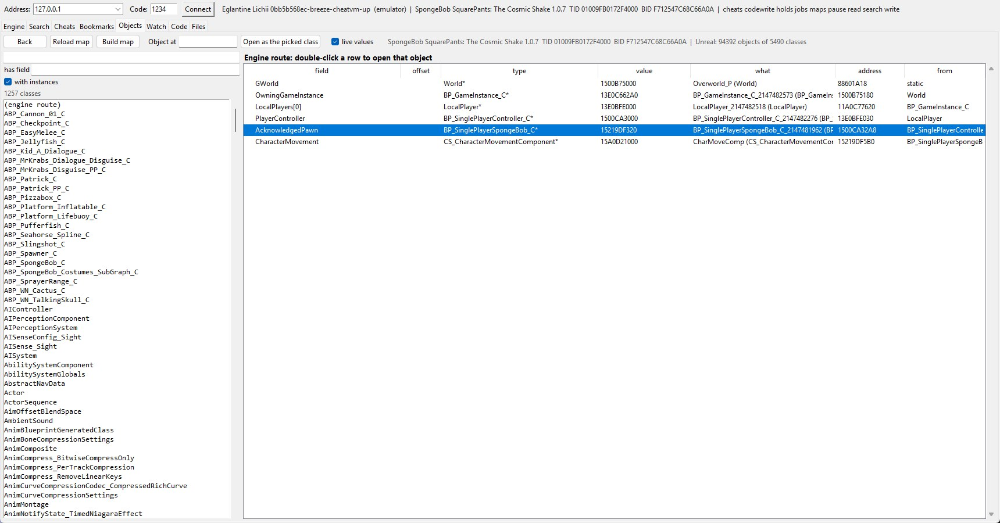
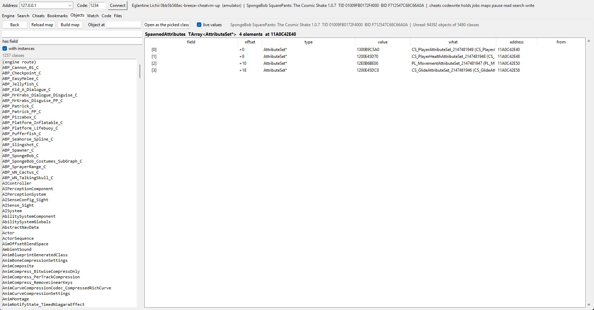
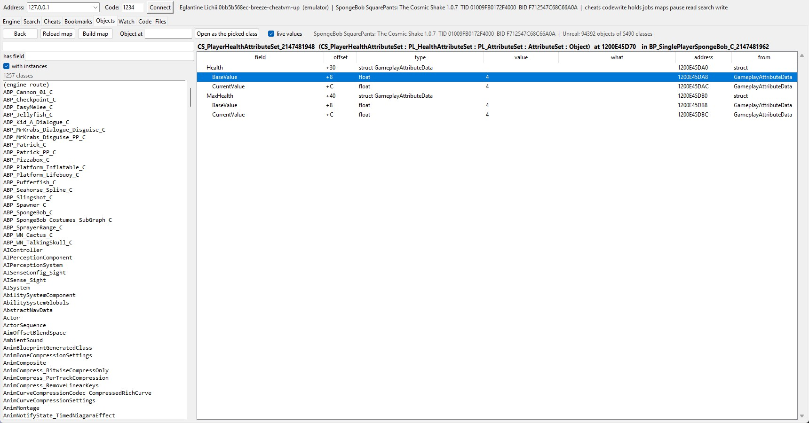
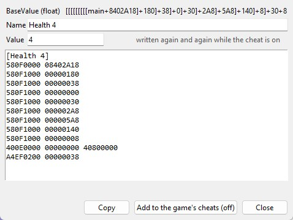
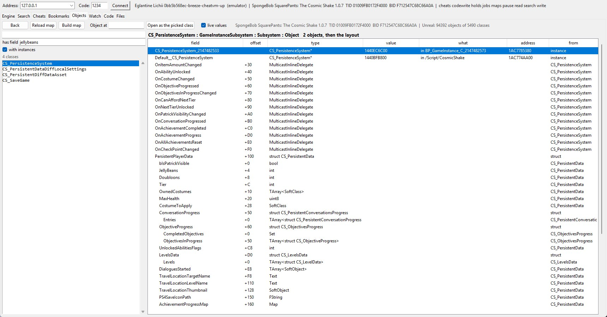
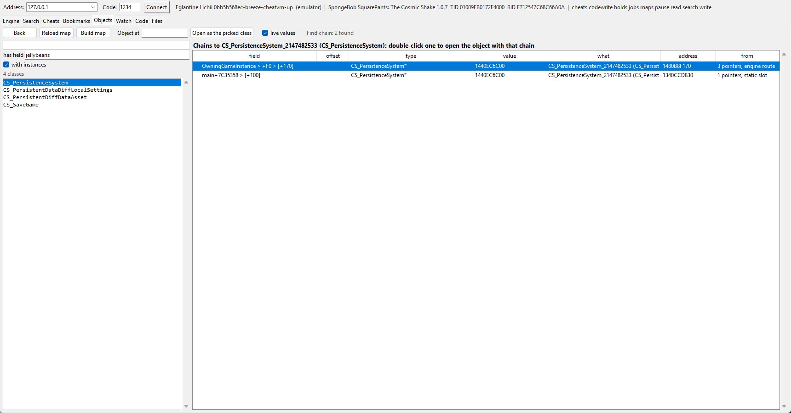
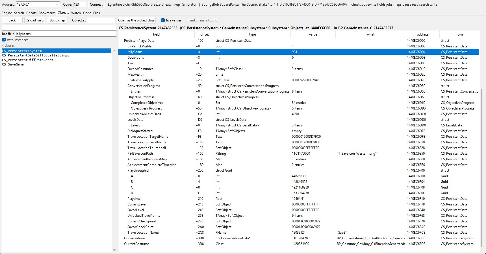
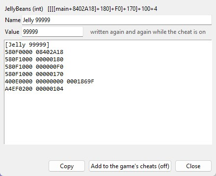
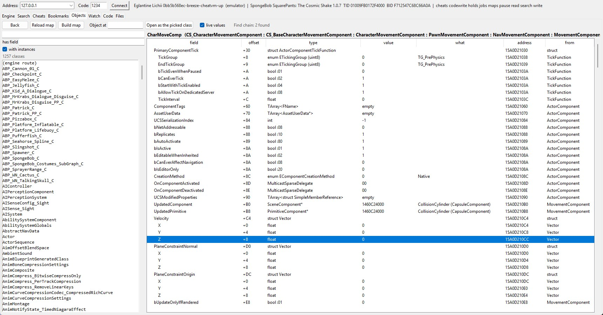

# Making cheats with Breeze Studio: SpongeBob The Cosmic Shake

A walkthrough of seven cheats for an Unreal game, made in Breeze Studio's **Objects** tab with
the game running in an emulator: health, glide, moon jump, jelly, doubloons, abilities and run
speed. The game is *SpongeBob SquarePants: The Cosmic Shake* 1.0.7 (`01009FB0172F4000`, build
`F712547C68C66A0A`, Unreal Engine 4.27). The finished cheats and the game's layout are in
[SpongeBob_Cosmic_Shake_cheats.md](./SpongeBob_Cosmic_Shake_cheats.md); the tool itself is in
[breeze_studio.md](./breeze%20studio.md).

No memory search is used. An Unreal game describes its own classes and fields, so the work is
to find the right field by name, get a pointer chain to it, and turn the chain into a cheat.

## Before you start

1. Start the game and load a save, so the player exists.
2. Start Breeze Studio and connect (an emulator: `127.0.0.1`, the code the emulator shows).
3. Open **Objects**. If the status line says the profile is missing, press **Build map**; for
   this game it took 1.6 seconds.

The list opens on **(engine route)**: the chain every Unreal game has, from the world to the
player. A few seconds later the list holds every class (here 94,392 objects of 5,490 classes,
read in about 5 seconds).



## 1. Health: walk down from the player

The player's health is not a field of the player. This game uses Unreal's Gameplay Ability
System, where numbers like health live in *attribute sets* that hang off an ability component.

1. Double-click **AcknowledgedPawn** (the player, `BP_SinglePlayerSpongeBob_C`).
2. In its fields, double-click **AbilitySystemComp**.
3. Double-click **SpawnedAttributes**. It is an array; the **what** column names each set.



4. Double-click `[1]`, the `CS_PlayerHealthAttributeSet`. It has `Health` and `MaxHealth`, each
   with a `BaseValue` and a `CurrentValue`.



5. Check it is the right value: double-click `BaseValue` under `Health`, type `2`, and look at
   the game. Put it back to 4.
6. Right-click `BaseValue` > **Make cheat...**. The box shows the row's chain as cheat code,
   with the value you type.



The lines are: `580F0000` reads the pointer at `main+8402A18` (GWorld) into register F, each
`580F1000` follows one more pointer, `400E0000` puts the value in register E, and `A4EF0200`
stores 4 bytes of E at F plus the last offset.

**Add to the game's cheats (off)** puts it in the cheat list. This is already a working
"health is 4" cheat. Two hand edits in the **Cheats** tab make it the final one:

- Health should follow the maximum, not a fixed 4. Replace the `400E0000` line with
  `540E2F00 00000048`, which loads `MaxHealth.BaseValue` (set offset +48) into E.
- Write both values of `Health`. Add a second store, `A4EF0200 0000003C`, for `CurrentValue`.

**Infinite glide** is the same walk into set `[3]`, `CS_GlideAttributeSet`: load `MaxGlideTime`
(`540E2F00 00000038`) and store it to `GlideTimeLeft` (`+48` and `+4C`).

## 2. Jelly and doubloons: find the field by name

Money is not on the player at all, so there is nothing to walk to. Search for it.

1. Type `jellybeans` in **has field**, under the class filter. The list keeps the classes that
   have a field of that name, including fields of structs inside a class. Four classes remain.
2. Pick `CS_PersistenceSystem`. It has one live object and its default object; the field
   `PersistentPlayerData` holds `JellyBeans`, `Doubloons` and more.



An object opened from this list has **no chain**: Studio knows where it is now, but not how
the game gets to it, and a cheat needs the way from main. Make cheat says so and refuses.

3. Right-click the live object > **Find chain to this object**. Studio asks who points at the
   object, then who points at those, until it reaches main. Here it took 6 seconds.



Two chains came back, and each was walked forwards again to check that it reaches the object:

| Chain | Through |
|---|---|
| `[[[main+8402A18]+180]+F0]+170` | the engine route: GWorld, the game instance, and entry `+170` of the game instance's subsystem table |
| `[main+7C35358]+100` | a static slot in main and entry `+100` of a table |

The first one is used here. It goes through objects the engine itself uses to find this
system, and it is the one the finished cheats were tested with. The second is shorter, but
what that table is has not been looked at.

4. Double-click the first chain. The object opens, and now every row has a chain from main.



5. Right-click `JellyBeans` > **Make cheat...**, name it `Jelly 99999`, value `99999`, and add
   it. The same on `Doubloons` with `999`.



**All abilities unlocked** is the same on `UnlockedAbilitiesFlags` with the value `-1`: one
bit per ability, all of them set.

The finished save cheats carry one more safety, added by hand: entry `+170` is a place in a
table, and a table can be laid out differently on another run. They compare the class stored
beside the entry (`+168`) with the object's own class (`+10`) and write only when they match:

```
580E2F00 00000168     E = the class the table says
580F1000 00000170     F = the object
580D2F00 00000010     D = the object's own class
C085E5D0              only when E == D
...                   the value and the store
20000000
```

## 3. Moon jump and run speed: the movement component

1. Back on **(engine route)**, double-click **CharacterMovement**.
2. Under `Velocity`, right-click `Z` > **Make cheat...** with the value `1000`.



3. Right-click `MovementMode` > **Make cheat...** with the value `3` (Falling). Without it the
   game holds the player on the ground and the speed upwards is thrown away.
4. In the **Cheats** tab, put the two stores into one cheat: the second cheat's chain is the
   same, so only its last two lines (`400E0000 ...` and `A1EF0200 00000168`) are added to the
   first. Then **Condition key...** and choose ZL+B, so it runs only while the keys are held.

**Run speed** is `MaxWalkSpeed` in the same object: Make cheat with `1350` (it is 900).

There is a `MaxWalkSpeed` in the movement attribute set too (set `[2]` of step 1). Writing
that one changes nothing: the game copies it to the component only when its own code changes
it. When a value shows in two places, change each by hand first and see which one the game
obeys.

## 4. Test and save

1. In **Cheats**, turn one cheat on and watch the value in **Objects** (live values is on).
   Change the value by hand and see the cheat bring it back.
2. Turn it off again and put the value back if you do not want to keep it.
3. **Save to SD** writes the cheat file.

What was measured this way for each cheat is in the table in
[SpongeBob_Cosmic_Shake_cheats.md](./SpongeBob_Cosmic_Shake_cheats.md). The steps above were
run in the real window on an emulator; the three hand edits (health from the maximum, the class
check, the key and the second store of the moon jump) were made as cheat text, not through
these buttons.

## What Make cheat does not do

- It writes one fixed value. Copying one field to another (health from the maximum) is a hand
  edit of one line.
- It adds no key and no check. Use **Condition key...** in the Cheats tab.
- It needs a chain from main. Rows reached from the engine route have one; an object from a
  class's list needs **Find chain** first.
- A list of things that are not plain numbers cannot be written this way. The costumes here
  are an array of asset paths; with the doubloon cheat they can be bought in the shop instead.
