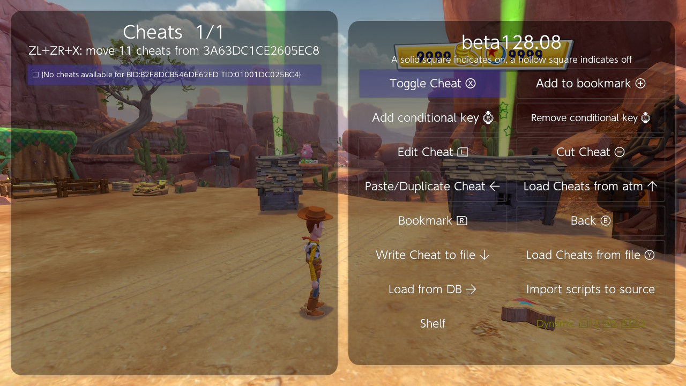
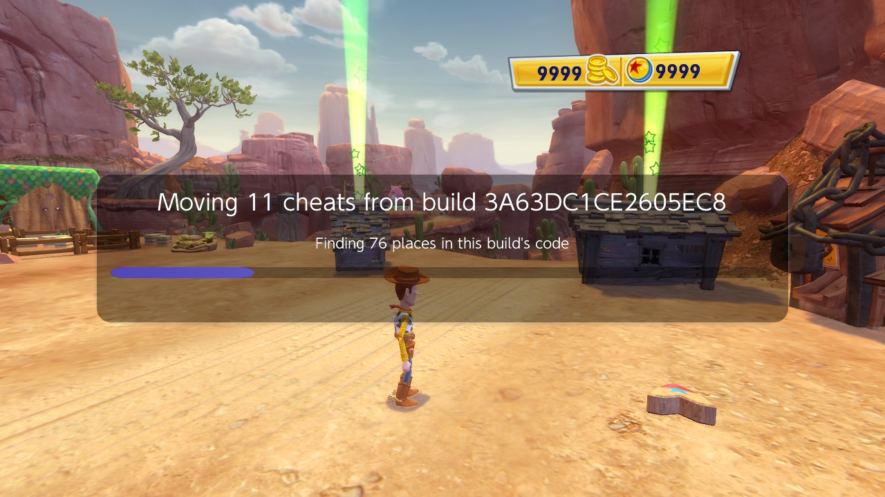
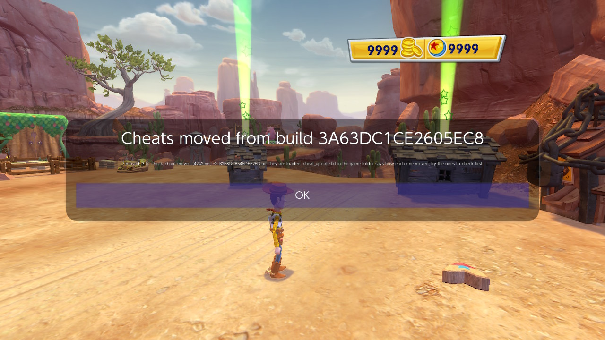
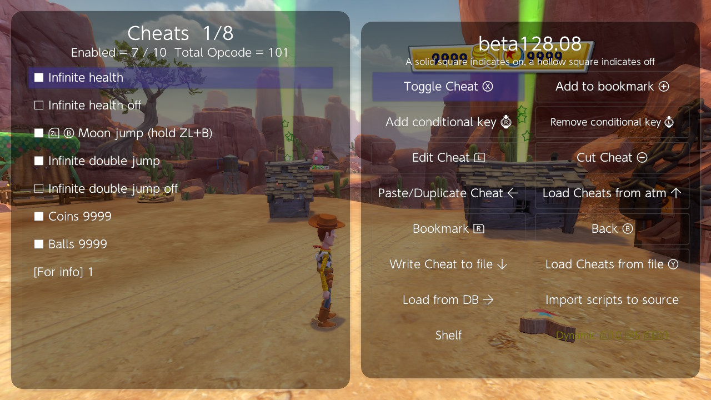

# Moving cheats after a game update

A game update changes the game's build id (BID), and a cheat file is made for one build. Cheats that write to fixed addresses, ASM hooks and code caves usually stop working, because the update moved the code and data they point at.

Breeze can move the cheats of the earlier build to the new one. It compares the two builds' code and finds where each address went, then writes a cheat file for the new build. This guide walks through one move, start to finish, on Toy Story 3 (1.0.1 -> 1.0.3, build 3A63DC1CE2605EC8 -> B2F8DCB546DE62ED). Every screenshot is from the console, on Breeze beta128.08. The move took 4 seconds; on a large Unity game it takes about half a minute.

**What you need**

- Breeze beta128.08 or later.
- Something to move from. Either:
  - **Breeze ran the old version with its cheats.** When a build has a cheat file, Breeze saves a copy of that build's code in the game folder (`codedump/`) by itself. That copy is what makes a move possible after the update, because the old version cannot be read once it is replaced. So start the game once with Breeze **before** you update it, or
  - **an update kit** of the old version (`kit_<BID>.bin.gz`): what a move needs to know about that build, without the game's code. Get Latest Cheat downloads one from MyNXCheats when there is no cheat file for your version, and you can copy one into the game folder yourself (see [Without the old version](#without-the-old-version-update-kits)).
- No cheat file for the new build yet. Breeze offers the move only when the new build has no cheats.

---

## 1. Open the Cheats screen

Update the game, start it, and open Breeze's **Cheats** screen. With no cheats for this build and an earlier build that can be moved, the line under the title says so:

**ZL+ZR+X: move 11 cheats from 3A63DC1CE2605EC8**



Breeze does not load or download cheats by itself here, so nothing gets in the way of the move.

## 2. Move them (ZL+ZR+X)

Press **ZL+ZR+X** (the action is **Move cheats from earlier build**). A box shows each stage as it runs.



Get the game to where you play before you move: some things a Unity game's cheats point at only exist once a save is loaded, and on its title screen those cheats come out "not moved".

## 3. Read the result

When it is done the box says how many cheats were moved:

**7 moved, 3 to check, 0 not moved (4242 ms) -> B2F8DCB546DE62ED.txt**



| Word | Meaning |
| --- | --- |
| moved | Every address in the cheat was found in the new build with no doubt. |
| to check | Moved, but at least one address was found in a way that can be wrong. The cheat is in the file; try it first and watch what it does. |
| not moved | An address could not be found. The cheat is still in the file, with its old addresses, so do not turn it on. |

Press **OK**.

## 4. Try the cheats

The moved cheats are written as `<new BID>.txt` in the game folder and loaded.



Try the ones to check first. If one does something wrong, turn it off; when an ASM cheat comes with an "off" cheat (like "Infinite health off" here), turn that one on to put the game's code back.

---

## cheat_update.txt: how each cheat moved

The move writes `cheat_update.txt` in the game folder. It starts with the counts and the time of each stage, then has one block per cheat. A line starting with `?` is the reason a cheat is to check. From this move:

```
[Infinite double jump] moved
    cave 0xD27900 (0x38 bytes) -> 0xD27BC0 in Game-TS3.consumer.nss
      cave +0x10: ADRP 0x12B8607 -> 0x12B8E26 (string "DoubleJump", the only one in read-only data)
    store 0x89ED8 -> 0x89ED8 (loose code match, 8 words; branch to 0xD27BC0)
[  Moon jump (hold ZL+B)] MOVED, CHECK
  ? main+0x17DCC88: no code loads it by its address, so it was moved as the statics around it were
    load main+0x17DCC88 -> 0x17DDF88 (static no code loads by its address; the 6 statics nearest it that the code loads (...) all moved +0x1300)
[Coins 9999] MOVED, CHECK
  ? offset +0x8 from a pointer Breeze can't name
    load main+0x17DFDB8 -> 0x17E10B8 (static, from 48 places in the code that load it)
```

How to read it:

- `store A -> B`: a code patch or hook at A in the old build is at B in the new one. "code match, 8 words" means the 8 instructions around it were found unchanged.
- `cave A -> B`: a code cave was moved, and every branch and address inside it was rewritten (`cave +0x10: ...`).
- `load main+A -> B`: a pointer cheat's start (a static) moved. "from 48 places in the code that load it" means every piece of code that used it agreed on the new address.
- `offset +0x8 from a pointer Breeze can't name`: the offset after the pointer is kept as it was. It is right unless the update changed the layout of that object; on Unity and Unreal games Breeze knows the field names and checks them, on other games it can't, so it says so.

Each block names its reason in words, so read the block of any cheat that does not work.

---

## Without the old version: update kits

A console that never ran the old version has no saved copy of its code. An **update kit** carries what a move needs instead: the old build's cheat file, and for each address a cheat uses, the instructions around it in a form that can be compared but holds none of the game's code.

- **Breeze writes the kit** of every build it saves code for, as `kit_<BID>.bin.gz` in the game folder. Share it with the cheat file.
- **Get Latest Cheat** looks in the game's folder of MyNXCheats. When there is no cheat file for your build but there is a kit of an earlier one, it downloads the kit and installs it: "Update kit installed: ZL+ZR+X moves its cheats to this build". Then do steps 1-4 above.
- **By hand:** copy `kit_<old BID>.bin.gz` into the game folder (`sdmc:/switch/breeze/cheats/<game>/`) with FTP or an SD card reader, then open the Cheats screen. The kit is installed and the move offered as in step 1.

A move from a kit gives the same cheats as a move from the saved code.

---

## Good to know

- **The move is offered only when the new build has no cheat file.** If Get Latest Cheat already downloaded one (from a cheat site), that file is used and nothing is moved. To move anyway, rename or delete `<new BID>.txt` in the game folder and open the Cheats screen again.
- **Breeze keeps the code of the last 2 builds** of a game. Older builds can still be moved from a kit.
- **"Nothing to move"** says why: "this build has a cheat file already", "no earlier build of this game has its code saved and a cheat file", or "the cheat file of build ... has no cheats".
- **Your cheat source file** (`<TitleID>.ini`, see [Cheat Source](cheat%20source.md)) gets a `[build <new BID>]` section with the moved addresses, so its names follow the update too.
- **The old cheat file is not changed.** If you go back to the old version, its cheats are still there.
- **Make cheats with Breeze's own tools when you can.** A pointer cheat made with Make cheat, a field view or the Unity menu records the names of the fields it goes through, and after an update those names find the fields again even when the game moved them.
