# Cheat source tutorial (beta127.00)

This tutorial takes the cheats of one game from "made in the ASM Composer"
to a **cheat source file**: one file that holds the source of the game's ASM
and pointer cheats, written so that a game update needs only the new
addresses. It then shows what the file gives you: editing a cheat in place,
turning a value into a list of cheats (a mod), keeping deleted cheats on a
shelf, and an editor on the PC.

Needs Breeze **beta127.00** or later. The screenshots are from Harvest Moon:
Echoes of Teradea 1.2.0 (title 0100839022642000, build 3DCC79312B977CD1),
whose cheats are in [MyNXCheats](https://github.com/tomvita/MyNXCheats). The
full reference for the file is [Cheat source](cheat%20source.md).

## 1. The idea

An ASM cheat holds addresses that belong to one build of the game: the
instruction it hooks, the functions it calls, the data it reads. When the game
updates, all of them move, and every cheat has to be made again.

The source file keeps those addresses apart. The code uses names, and a
`[build]` section per game version says what each name is:

```ini
[cheat Move speed (player)]
hook = speed_site
place = fixed
code =
    ldrb w9, [x19, #0x2c]
    cbz w9, plain
    ldr s11, move_speed_factor
    fmul s11, s0, s11
    b code1+4
    plain:
    {original}
    b code1+4
    move_speed_factor: .float 1.0

[build 3DCC79312B977CD1]
speed_site = M+27D72C0 stock 1E20400B
moon_jump_flag = M+A8BE114
game_info_slot = M+A740640
```

After an update you add a `[build <new id>]` section with the same names and
the new addresses, and Breeze builds every cheat again from the same code.
The `stock` word is what the game has at that address; Breeze refuses to hook
a build where the word is different, so a wrong address cannot break the game.

The file is `<TitleID>.ini` in the game's folder:
`sdmc:/switch/breeze/cheats/<game name>/0100839022642000.ini`.

## 2. From the cheats you have

The three buttons for the file are on the Cheats screen, second page of
buttons (the `All 1/2 -> 2/2` button turns the page):

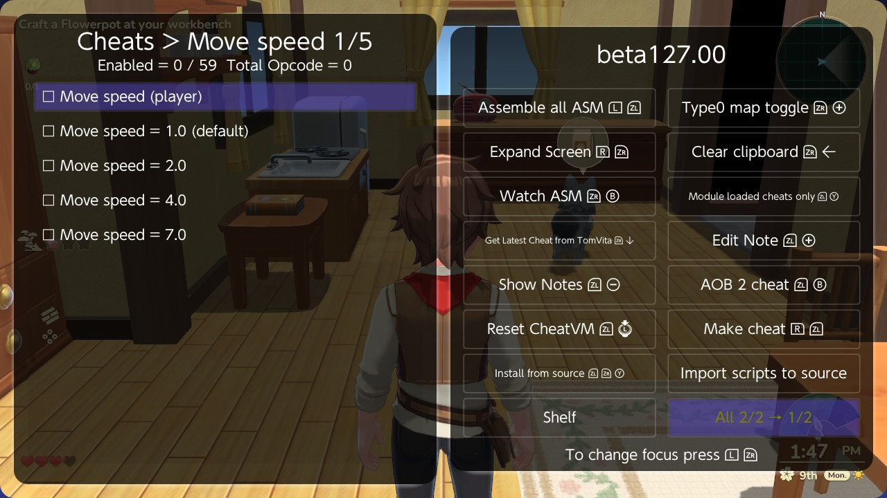

- **Import scripts to source** writes the loaded cheats into the file: every
  ASM cheat made with the composer (its script file) and every plain pointer
  cheat (a `580F0000` base, `580F1000` reads, a `780F0000` add and one
  write). The hook becomes a name with its stock word; the key, on / off and
  the cave's place come along.
- **Install from source** (ZL + ZR + Y) builds every cheat of the file that is
  not in the list. Cheats that cannot be built (a missing name, a stock word
  that does not match) are listed with the reason.
- **Shelf** is section 7.

Import copies the code as it was written. Numbers in it that are addresses
still belong to this build: give them names with **Name address** (section 4).

## 3. What a cheat from the file looks like

An ASM cheat from the file is one row in your list, its **hook**. Edit Cheat
shows it:

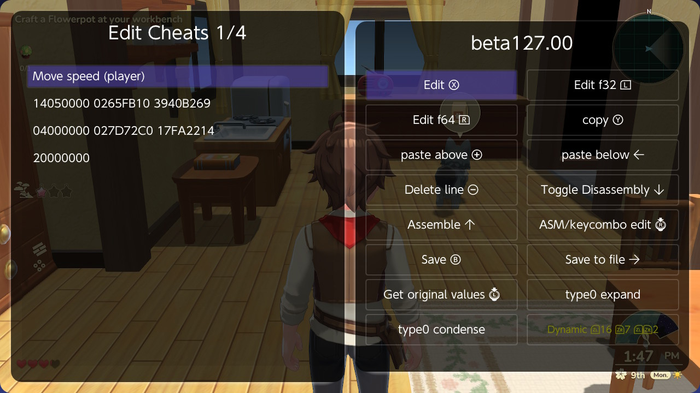

```
14050000 0265FB10 3940B269    only if the cave holds its code...
04000000 027D72C0 17FA2214    ...write the branch into the game
20000000
```

The cave's code itself is kept in a `[code cave]` folder at the end of the
cheat file, and Breeze writes it into the game for you: when the file is
loaded, when the cheat is built, and when you turn the hook on. The first
line checks that the cave is really there, so the hook can never jump into an
empty cave.

On the Cheats screen it works like any ASM cheat: on; off with the code left
in (green); off with the game's own instruction back.

**Giving the cheat file to someone with another cheat manager:** they see the
hook, and in the `[code cave]` folder the cave fill and an `(off)` cheat. Turn
the cave fill on once (then off), then use the hook. After turning the hook
off, turn the `(off)` cheat on once to put the game's instruction back.

## 4. The Cheat composer

The ASM Composer is now the **Cheat composer**. Edit Cheat on a cheat from the
file, then **ZL + Y** (Cheat composer): the title says `source`, and the lines
are the cheat's code from the file, names and all.

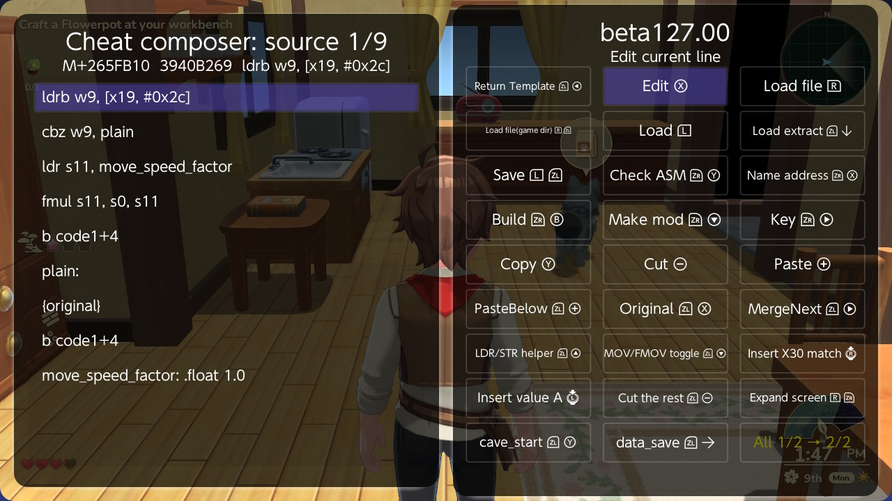

The status line shows where the cursor's line is in the game and the word
there. The new buttons:

| Key | Button | What it does |
|---|---|---|
| ZR + Y | Check ASM | Checks the code as this build fills it in. A note goes on each line with a problem; a name this build does not have is noted too. |
| ZR + X | Name address | The number on the line becomes a name. Breeze suggests the function or field it knows the address as; you can change it. `name = M+...` goes into the `[build]` section and the line gets `{name}`. On an `adrp` line the page and the low 12 bits used by the next line become `{name:page}` and `{name:lo12}`. |
| ZR + B | Build | Saves, closes the composer and rebuilds the cheat where it is, back on if it was on. |
| ZR + Down | Make mod | Section 5. |
| ZR + Right | Key | The buttons held for the cheat to run (`ZL+ZR+X`, empty for none). Then builds. |

**Save & Back** (B) writes the lines back into the file and nothing else; when
nothing changed, nothing is written.

**When the cave grows.** Build first assembles the new code to see how big it
is. If it needs more room than it had, the words after it must be free (zero
in the game and part of no other cave). If they are not, Breeze puts the cave
somewhere else; if no gap is big enough it packs all the caves again and tries
once more. A cheat marked `place = fixed` (a cave you placed by hand) is never
moved: Build stops and says what is in the way. If a build fails, the cheat is
put back as it was.

## 5. Mods: one value, a list of cheats

A *mod* turns a value in a cheat into a choice. Move speed multiplies the
player's speed by `move_speed_factor`; a mod makes one cheat per factor:


Only one value is on at a time. Turning one on turns the others off; turning
it off writes the first value (the default) back.

**Making one.** In the Cheat composer put the cursor on the line that holds
the value and press **ZR + Down** (Make mod). Breeze asks for a name, then for
the values, separated by `;`:

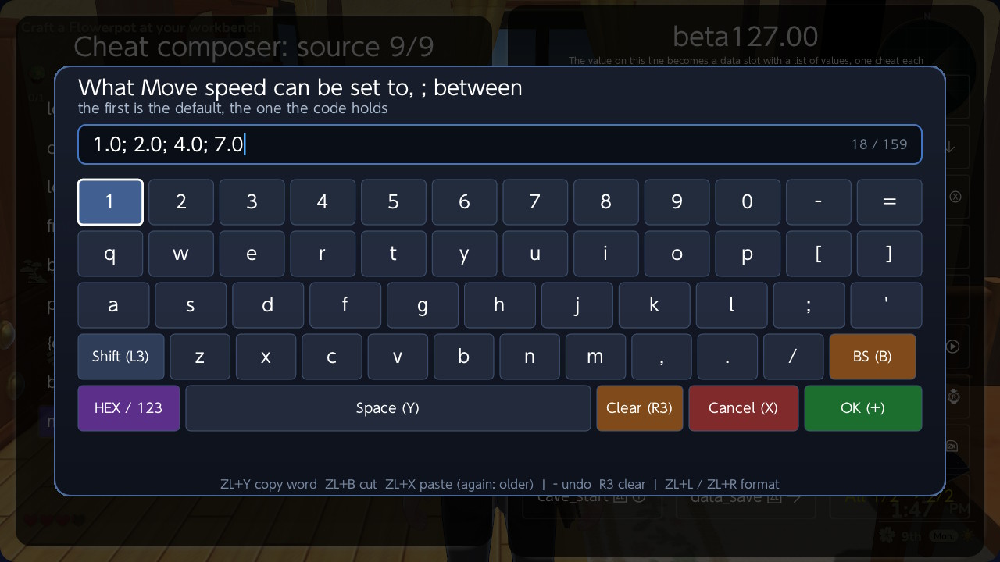

The first value is the default. Breeze moves the value into a data slot after
the code (`ldr s11, move_speed_factor` and `move_speed_factor: .float 1.0`
above), writes a `[mod]` section and builds:

```ini
[mod Move speed]
cheat = Move speed (player)
at = move_speed_factor
type = f32
values = 1.0; 2.0; 4.0; 7.0
```

Make mod works on:

- `fmov s3, #2.0` and `fmov d1, #2.5` (a float),
- `mov w1, #0x481` and `mov x2, #5` (a number),
- a constant built with `movz` / `movk`, with or without the `fmov` that moves
  it into a float register,
- a slot line itself (`move_speed_factor: .float 1.0`): a new mod for that
  slot, or, when it has one already, its values to edit.

The code has to end in a branch (`b code1+4`, `br` or `ret`), or the slot
after it would run as an instruction. A cheat can have several mods.

**Changing the values later.** Edit Cheat on any of the value cheats opens the
whole list:

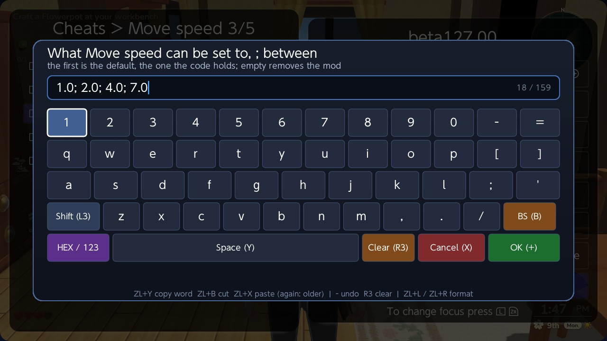

Add, change or remove values and press OK; the cheats follow, keeping their
on / off. A new first value becomes the default in the code too.

**Names for the values.** Write `label = value`:

```ini
values = 6:00 AM = 0; 9:00 AM = 180.0; 12:00 PM = 360.0; 3:00 PM = 540.0; 6:00 PM = 720.0; 9:00 PM = 900.0
```

and the cheats are called by the label:

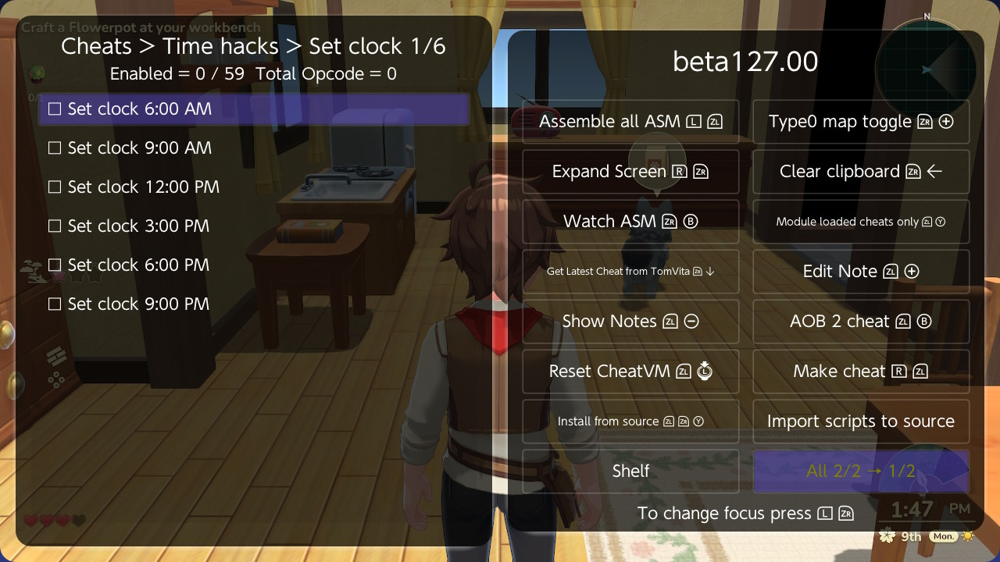

**Removing a mod.** Clear the list in that keyboard and press OK: the mod
leaves the file, its value cheats leave the list, and the cheat stays where it
was. Or delete the slot line in the Cheat composer and press Back.

## 6. Pointer cheats

A pointer cheat is two lines in the file:

```ini
[cheat Money 999,999]
on = no
chain = {game_info_slot} B8 0 68 58
write = u32 999999
```

`chain` is the base (a name of the build), the offsets that are read, and the
last offset, which is added. `write` is the type and the value. Breeze builds
the usual pointer cheat from it. After an update only `game_info_slot`
changes, in the new `[build]` section.

The Cheat composer opens a pointer cheat as its lines and shows, at the top,
the chain walked in the game right now and what the target holds:

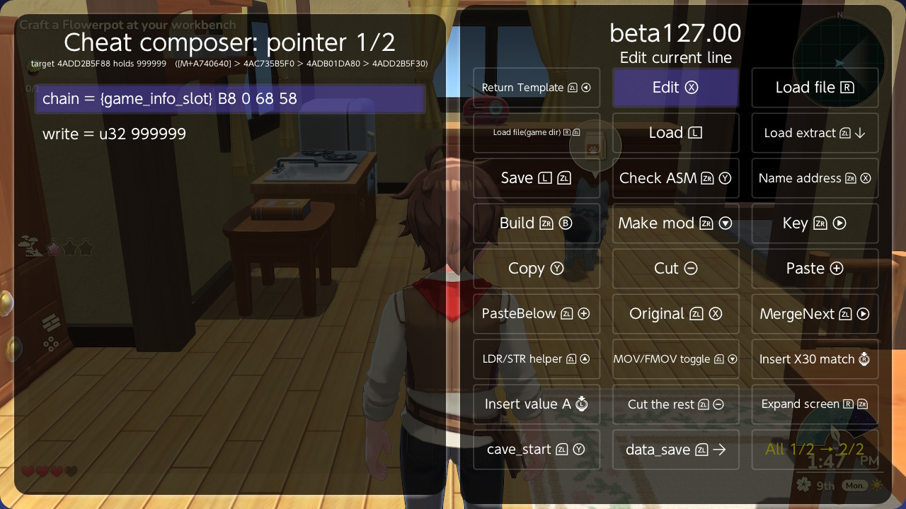

Name address on the `chain =` line names its base; Make mod gives `write` a
list of values.

**Several cheats from one chain.** Teradea had six "Set clock" cheats that
differed only in the value. In the file they are one cheat marked as a
template and one mod:

```ini
[cheat Set clock (turn off after)]
template = yes
chain = {clock_slot} B8 0 40 18 54
write = f32 0

[mod Set clock]
cheat = Set clock (turn off after)
values = 6:00 AM = 0; 9:00 AM = 180.0; 12:00 PM = 360.0; 3:00 PM = 540.0; 6:00 PM = 720.0; 9:00 PM = 900.0
```

A template is not put in the list; its values are the cheats (the Set clock
folder above). Install from source makes them.

## 7. The shelf

Delete a cheat from the file in your cheat list (Cut Cheat, or any other way)
and it is not lost. The next time the cheat file is written, Breeze marks it
`shelved` in the source file, puts the game's instruction back and frees its
cave. **Shelf** lists what is there, with where each cheat was:

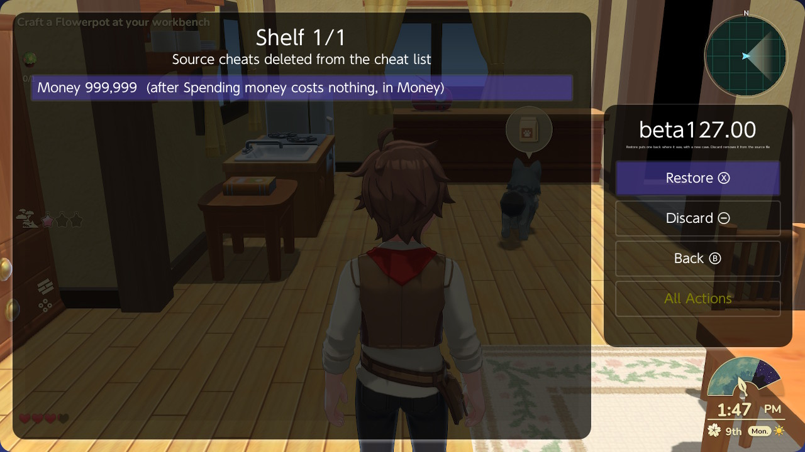

**Restore** (X) builds it again and puts it back where it was:

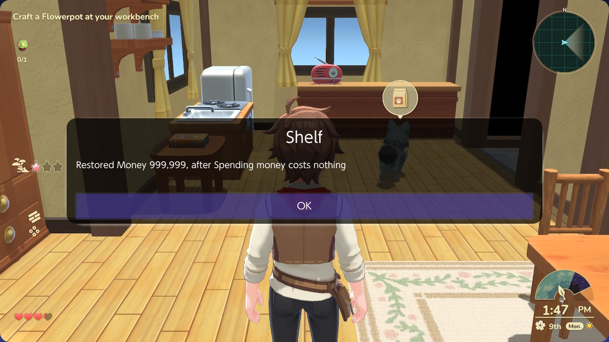

**Discard** (Minus, twice) removes it from the file for good. If there is no
room for a restored cheat's cave, Breeze lists the caves in the game, largest
first, so you can shelve one to make room.

Moving a cheat with Cut and Paste is not a delete: it is back in the list
before the file is written.

## 8. On the PC

The PC app (in `pc_app.zip`, with the new `pcconnect_source.py`) has a
**Cheat source** button. It opens the running game's file:

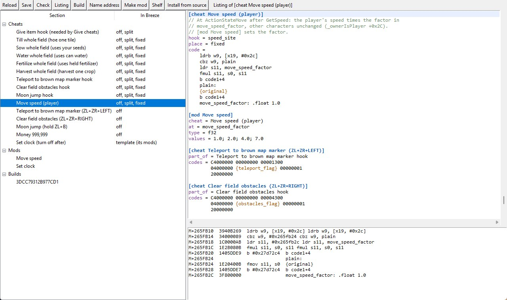

On the left are the sections with each cheat's state in Breeze; on the right
the file as text. The buttons work on the section the cursor is in:

| Button | Key | What it does |
|---|---|---|
| Save | Ctrl + S | Writes the file to the Switch. |
| Check | F7 | Check ASM; lines with a note are marked. |
| Listing | F8 | Each code line with its address in the cave and the word the game holds there (above). Double-click a row to go to its line. |
| Build | F9 | Saves, then rebuilds the cheat on the Switch. |
| Name address | Ctrl + N | As in the Cheat composer, on the line the cursor is on. |
| Make mod | Ctrl + M | As in the Cheat composer; asks for the name and values. |
| Shelf | | The shelved cheats, with Restore and Discard. |
| Install from source | | As on the Switch. |

Breeze on the Switch does the work, so what the PC shows is what the Switch
builds.

## 9. After a game update

1. Find the new addresses of the names (an AOB search, or the function map).
2. Add a `[build <new build id>]` section with the same names. Diagnostics
   (below) shows the build id of the running game.
3. Install from source. A cheat whose names are missing, or whose hook's stock
   word does not match, is reported and left out; the others are built.

## 10. Diagnostics

Not part of the source file, but new in beta127.00: **Main > Diagnostics**
(ZR + R) lists what a problem report needs.

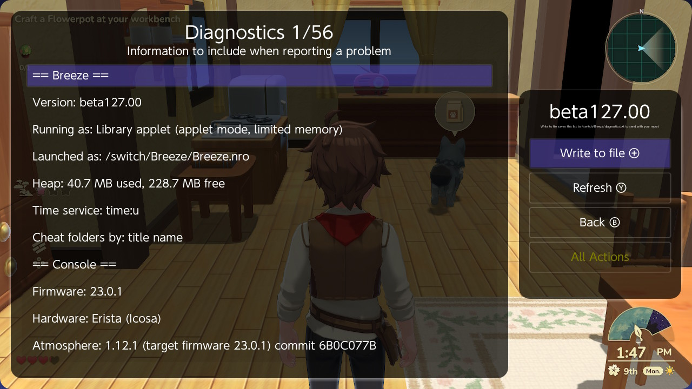

Versions, firmware, Atmosphere, the cheat service, the running game and its
build id, sysmodules and the newest crash reports. **Write to file** (Plus)
saves it to `/switch/Breeze/diagnostics.txt`; send that file with your report.
