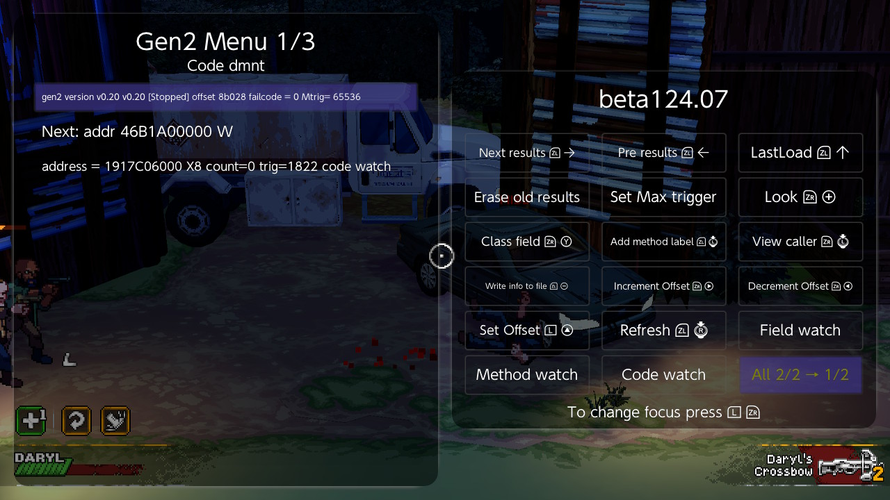
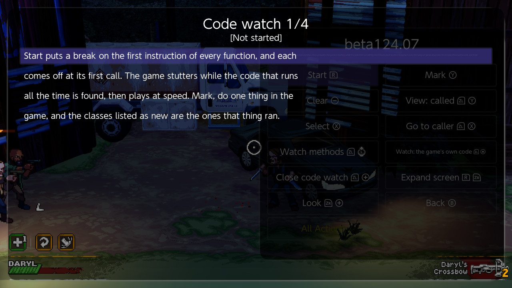
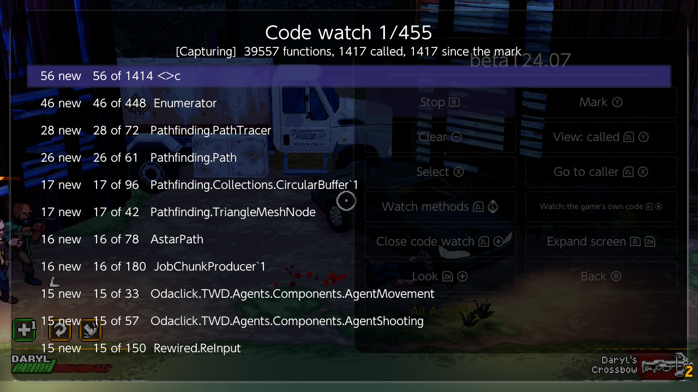
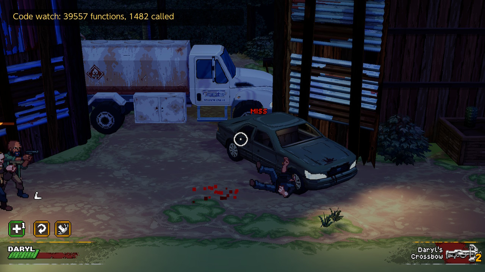
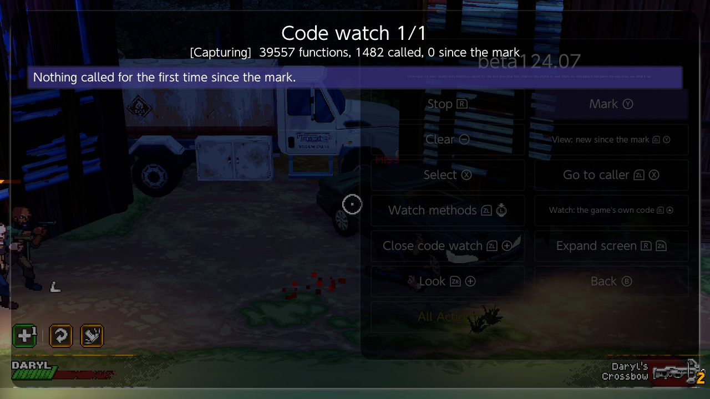
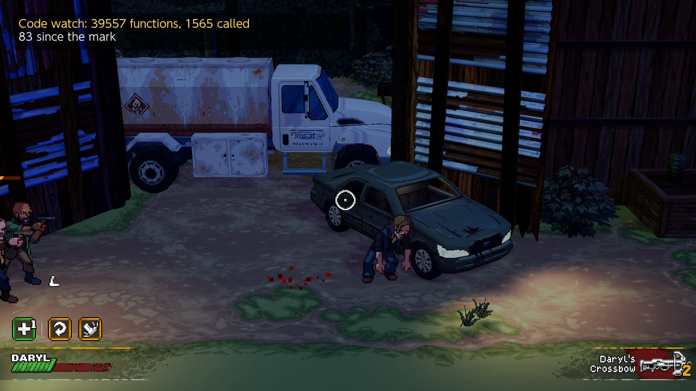
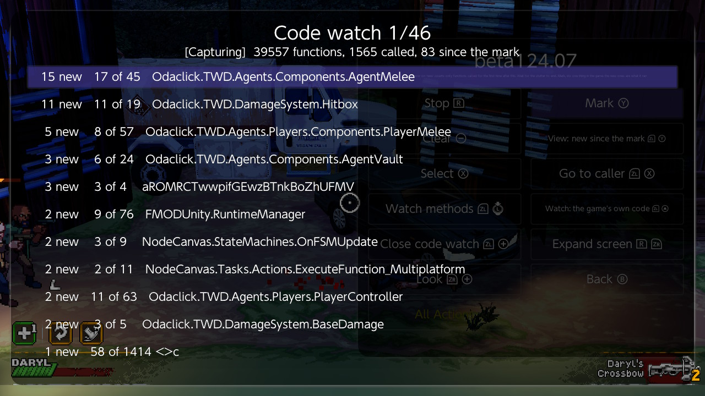
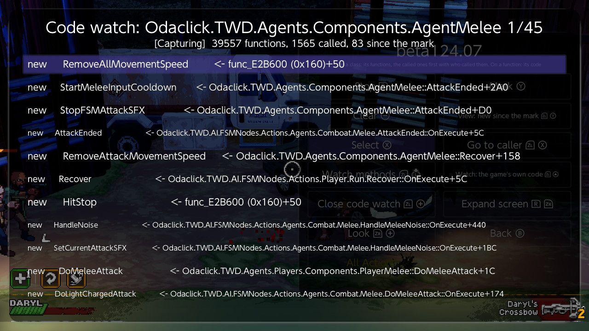
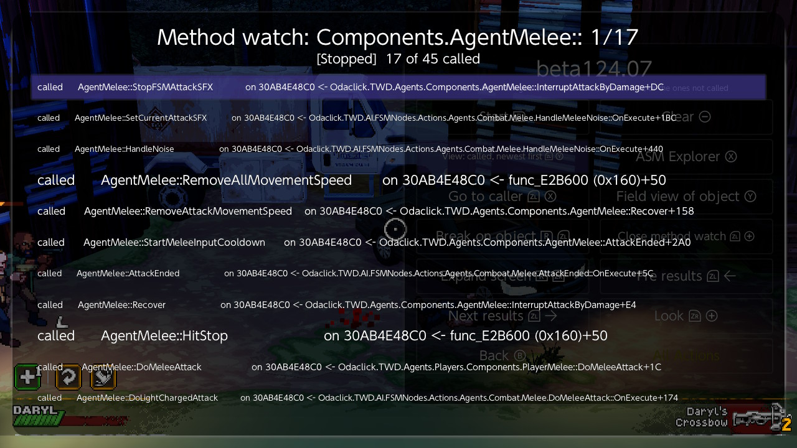
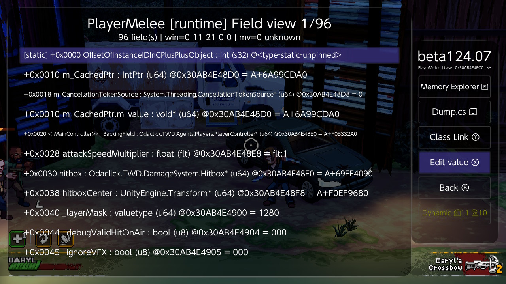

# Code watch walkthrough: from one attack to the player's fields

You pressed a button in the game and something happened. Which part of the game's code did it, and where is the object it belongs to?

This walkthrough finds that out for one melee attack, start to finish, on a Unity game (The Walking Dead: Streets of Survival). It takes about two minutes and uses no search, no known address and no guessed name. Every screenshot is from the console, on Breeze beta124.07.

The reference for every button is the [watch fields, watch methods and code watch guide](watch%20fields%20and%20methods.md).

**What you need**

- Breeze beta124.07 or later, with the gen2 fork that comes with it (Settings > Install gen2 fork, then reboot).
- The game's function map. On a Unity game the Unity menu builds it; if you have opened a class's Methods list before, it is already there. A GameMaker (YYC) game needs nothing: Start makes it.

---

## 1. Open Code watch

On Main press **Gen2 Action**, go to the second page of the gen2 menu, and press **Code watch**.

## 2. Start

The screen says what is about to happen. Press **Start** (R).

Breeze puts a break on the first instruction of every function of the game's own code: 39,557 of them here, in under a second. Each break comes off the first time its function is called, so every function can stop the game once and never again.

The list fills at once with the classes whose functions are running. This is the code that runs all the time: path finding, input, the characters' movement.

Each line reads: how many of the class's functions are new since the mark, how many were called out of how many watched, and the class.

## 3. Let the game settle

Go back to the game and just stand there. A box at the top left counts the functions called so far. The game stutters for a few seconds while the count climbs, then runs at full speed.

Wait until the number stops changing. Here it settled at 1,482.

Do not do the thing you are interested in yet. Anything you do now will not count as new later.

## 4. Mark

Open Breeze and press **Mark** (Y). The list empties: from now on it shows only what is called for the first time after this moment.

## 5. Do one thing

Go back to the game and do the one thing, once. Here: one melee attack.

The box gains a second line. The attack ran 83 functions that had not run before.

## 6. Read the list

Open Breeze. The classes are listed with the most new functions first.

The answer is at the top: `AgentMelee` (15 new functions), `DamageSystem.Hitbox` (11), `PlayerMelee` (5), and further down `BaseDamage`. Nobody had to know those names beforehand.

Lower in the list is plumbing the attack happened to touch for the first time: sound, a state machine, a compiler-made class with a scrambled name. The game's own classes with the most new functions are the ones to look at.

## 7. Look inside a class

Put the cursor on a class and press **Select** (X). You get its functions: `new` for the ones the attack ran, then the name, then who called it.

This reads like the attack's story: `DoMeleeAttack`, called from `PlayerMelee::DoMeleeAttack`; `HitStop`; `AttackEnded`; `StartMeleeInputCooldown`, called from `AttackEnded`. The cooldown that stops you attacking again at once is right there, with its name.

**Select** on a function opens its code. **Go to caller** (ZL+X) opens the code that called it. **Back** (B) returns to the classes.

## 8. Get the live object

Code watch tells you which functions ran, not which object they ran on. For that, hand the class to the method watch: with the cursor on the class (or inside it), press **Watch methods** (ZL + left stick click).

The code watch stops and a method watch starts on that one class. Go back to the game, attack once or twice more, and open Breeze again. Press **View** until it reads "called, newest first".

Each called method shows `on` followed by an address: the object it was called on. Here 17 of the class's 45 methods were called, all on `30AB4E48C0`: `DoMeleeAttack`, called from `PlayerMelee::DoMeleeAttack`, `HitStop`, `StartMeleeInputCooldown` and the rest. One address on every line means one object did all of it: the player's.

## 9. Open its fields

Put the cursor on a called line and press **Field view of object** (Y).

This is the player's melee component, a live object, with every field by name and its current value: `attackSpeedMultiplier`, `canAttack`, the cooldown, the hitbox. Breeze opened it as `PlayerMelee`, the class the object really is, although the method belongs to its parent `AgentMelee`.

From here the usual tools take over: Edit value, Watch fields to see which of these the game actually uses, or a pointer chain and Make cheat.

## 10. Stop

Go back to the Method watch screen and press **Stop** (R) if the watch is still running; the screenshot above was taken after stopping. Stop takes every remaining break out of the game's code. Do not leave a watch running when you are done.

---

## If it does not go like this

- **The list after the action is empty.** The action ran nothing new: its code had already run before you pressed Mark. Press **Clear** (Minus), wait for the count to settle again, **Mark**, and do it again.
- **The list is long and noisy.** Something else happened between Mark and your action: an enemy attacked, a sound played, the scene changed. Mark as late as you can and do only the one thing. Standing in a quiet spot helps.
- **The count never settles.** The game keeps running new code, as it does in a busy fight. Mark anyway and look at the classes with the most new functions.
- **Start says there is no function map.** Build it first: Unity menu on a Unity game.
- **The game stutters for a long time.** Leave **Watch** on "the game's own code". "Everything in the map" adds the engine's functions: more stutter and a longer list.
- **Stop also writes a file.** `code_watch.txt` in the game's Breeze folder lists every called function in the order of the first calls, with a `*` on the ones after the mark.

## The numbers from this run

| | |
|---|---|
| Functions watched (the game's own code) | 39,557 |
| Called while standing still | 1,482 |
| New after Mark, before the attack | 0 |
| New after one melee attack | 83 |
| Classes at the top | `AgentMelee` 15, `Hitbox` 11, `PlayerMelee` 5 |
| Breaks left in the game after Stop | 0 |
