# GameMaker walkthrough: variables by name, and a cheat from one press

This walkthrough makes two cheats for a GameMaker game without a memory search: one for a global value (money), and one for a value that belongs to the player (jump height). Along the way it finds out which game object an attack creates.

The game is Well Dweller, exported with the YoYo Compiler (YYC). Every screenshot is from the console on Breeze beta124.07. Nothing was prepared beforehand: Breeze reads the names from the running game.

The reference for the buttons is the [watch fields, watch methods and code watch guide](watch%20fields%20and%20methods.md) and the [GameMaker page](Game%20Maker.md).

**What you need**

- Breeze beta124.07 or later with its gen2 fork (Settings > Install gen2 fork, then reboot).
- A GameMaker game exported with YYC. Game Information names the engine; on such a game the **GameMaker** button on Main lights up.

---

## Part 1: a global value

### 1. Open the globals

On Main press **GameMaker**.

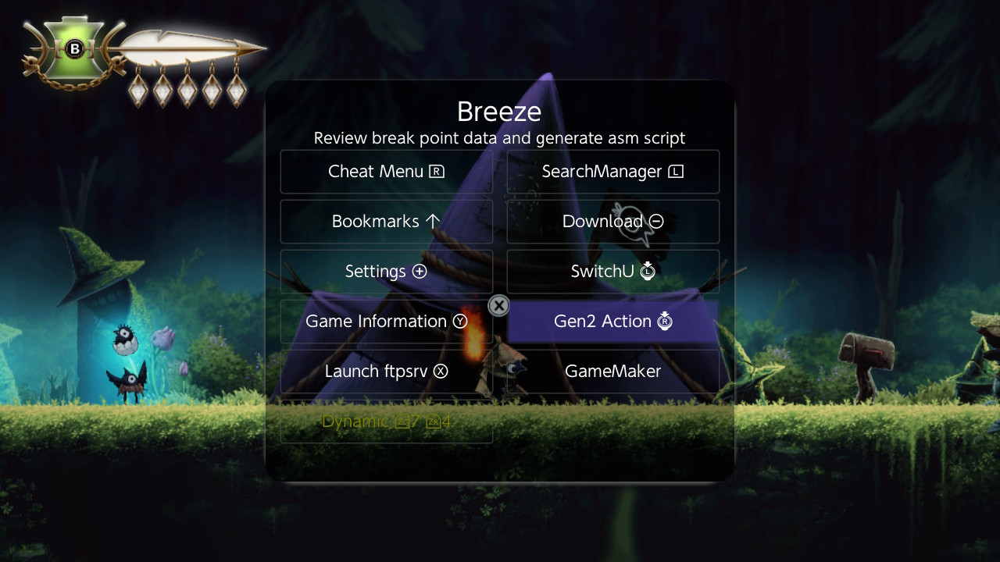

You get every global variable of the game by name, with its kind and its live value. This game has 1,233; the 413 that hold values are shown.

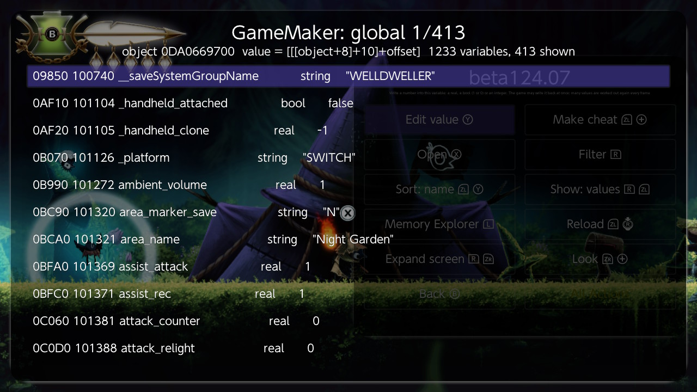

Each line reads: the variable's offset in the object, its id, its name, its kind, its value.

### 2. Find the one you want

Press **Filter** (R) and type part of a name. "health" leaves five lines, the player's health and its maximum among them.

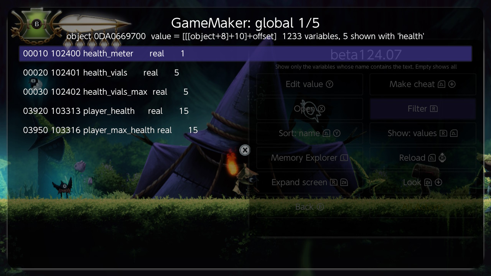

**Edit value** (Y) changes a value on the spot. That is the quickest test of whether a variable is the one you think it is.

### 3. Make the cheat

Filter to `currency`, put the cursor on it and press **Make cheat** (ZL+Plus). The Make cheat screen opens with the whole pointer chain already filled in, from the game's code down to the value.

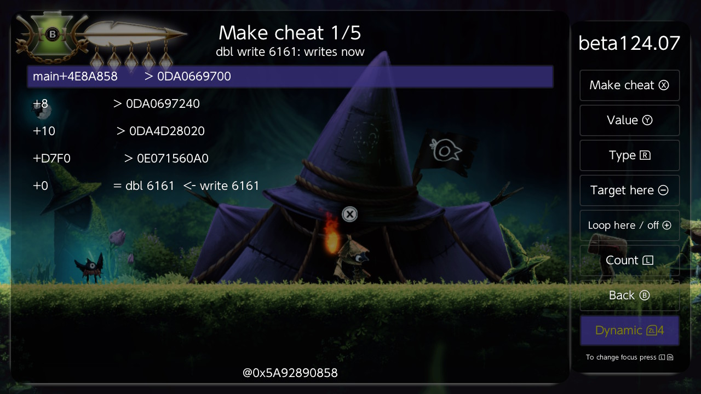

Press **Value** to choose what to write, then **Make cheat**, and give it a name. The cheat is added to the cheat list, off. That is all a global needs.

---

## Part 2: a value that belongs to an object

The player's walking speed, jump height and gravity are not globals. They belong to the player object, and the first job is to find out which object that is.

### 4. Start a code watch

Open the gen2 menu, go to its second page, press **Code watch**, then **Start** (R). On a GameMaker game there is nothing to prepare: Breeze reads the game's own table of events and scripts, 9,616 of them here.

Go back to the game and wait until the box at the top left stops counting. It takes a few seconds.

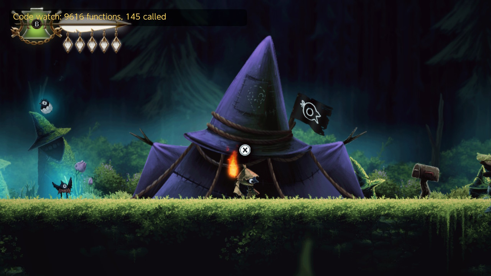

### 5. Mark, then do one thing

Open Breeze, press **Mark** (Y), go back to the game and do one thing. Here: one attack. Open Breeze again.

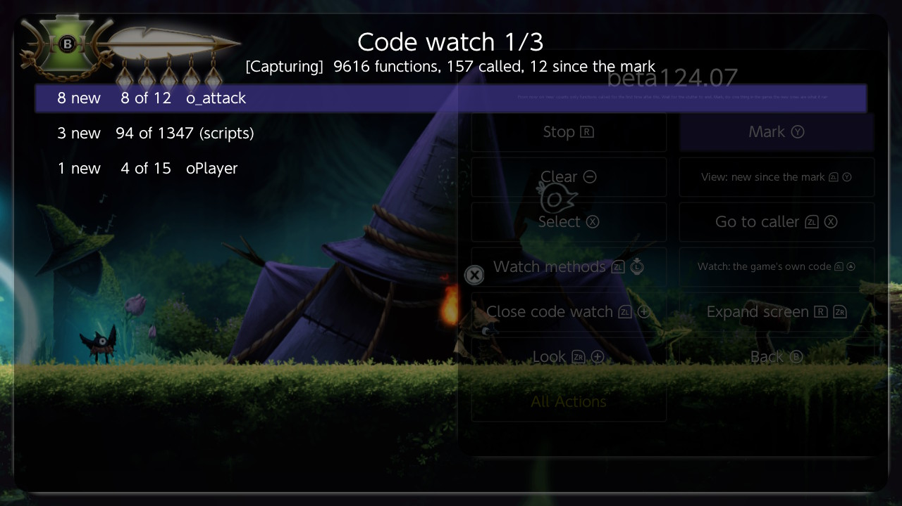

Three lines. The attack is its own object, `o_attack`; three scripts ran for the first time; and the player object ran one event it had not run before. On a GameMaker game the list is by object, and it is short because only the game's own code is in it.

### 6. Look at what the object did

Put the cursor on `o_attack` and press **Select** (X).

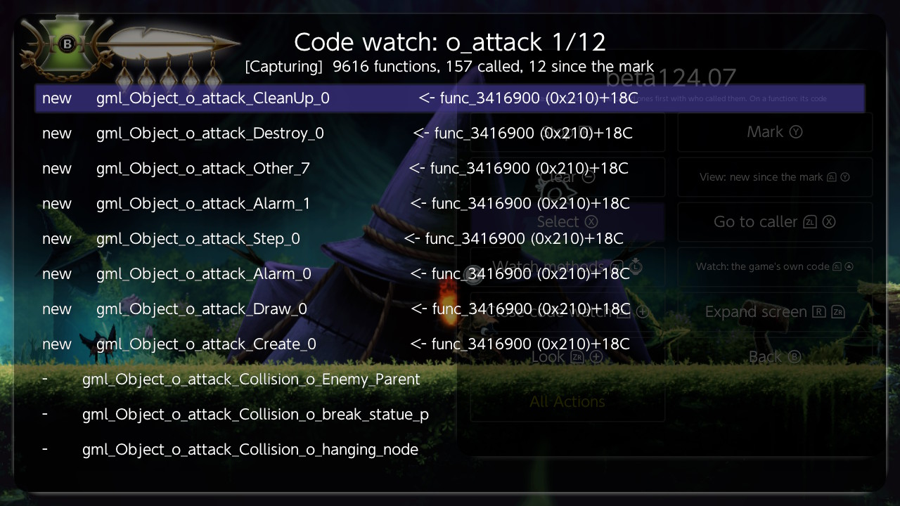

Its Create, Step, Draw, two Alarms and Destroy all ran. Its collision events did not: the attack hit nothing. That tells you where a hit would be handled: `gml_Object_o_attack_Collision_o_Enemy_Parent`.

### 7. Get the player's instance

Press **Back** (B), put the cursor on `oPlayer`, and press **Watch methods** (ZL + left stick click). Go back to the game for a second or two and open Breeze again. Press **View** until it reads "called, newest first".

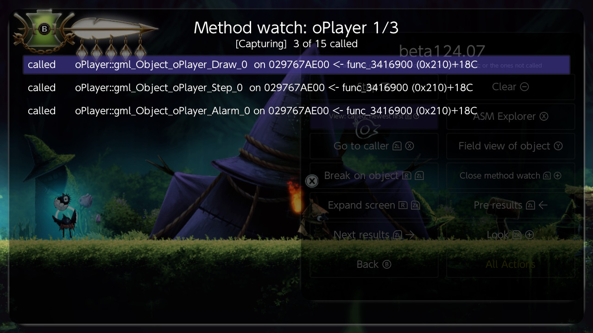

Each event that ran shows the object it ran on. All three lines show the same address: that is the player.

### 8. Open its variables

On one of those lines press **Field view of object** (Y).

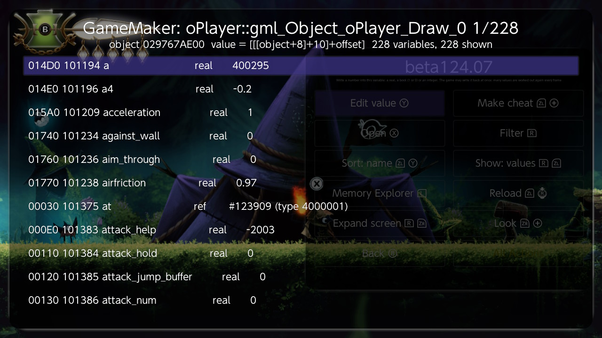

These are the player's own variables, 228 of them, with live values. **Filter** to "jump":

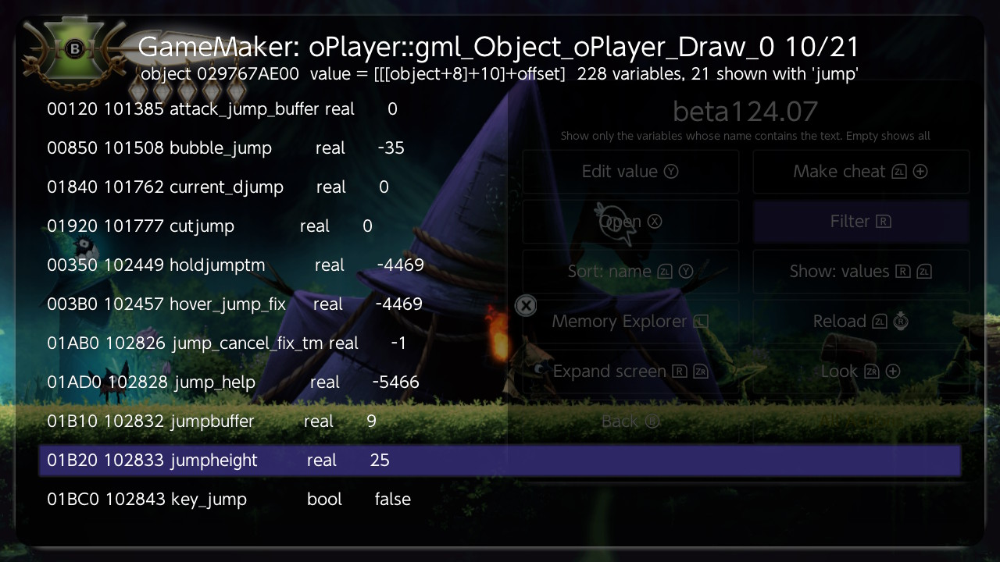

`jumpheight` is 25. **Edit value** will change it for now. To keep it changed, make a cheat.

### 9. Make the cheat

With the cursor on `jumpheight` press **Make cheat** (ZL+Plus). Type the value to hold (40 here), then a name for the cheat.

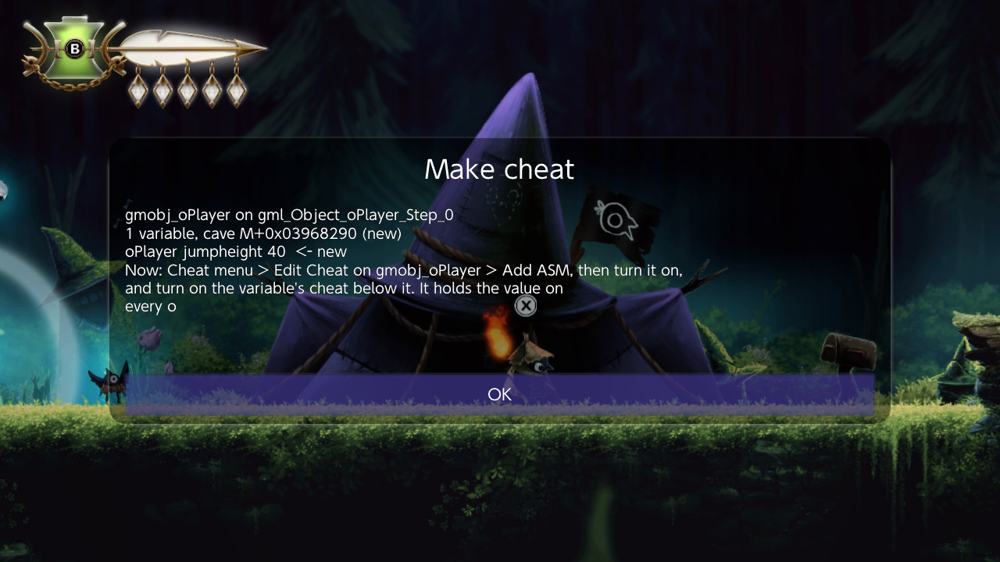

An object has no fixed place in memory the way a global has, so this cheat is a small piece of code on the object's Step event. Breeze writes it for you and tells you what to do next. (On beta124.07 the last line of this message is cut short; it reads "It holds the value on every oPlayer there is.")

### 10. Add ASM, once

Open the Cheat menu. Two new cheats are there: `gmobj_oPlayer`, the piece of code, and `oPlayer jumpheight 40`, the switch for your variable.

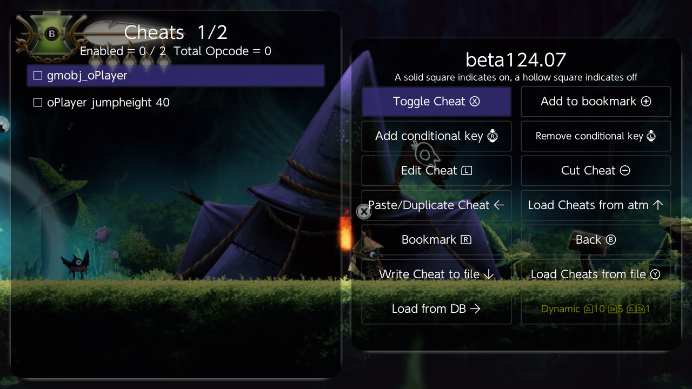

Put the cursor on `gmobj_oPlayer`, press **Edit Cheat**, then **Add ASM** (ZL+Up). Breeze assembles the code and shows it.

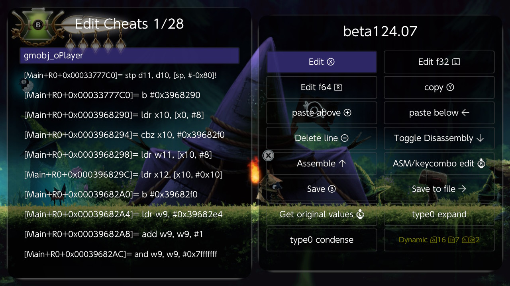

Press **Save** (B). You do this once for an object, and once more each time you add another of its variables.

### 11. Turn both on

In the cheat list turn on `gmobj_oPlayer` first, then `oPlayer jumpheight 40`.

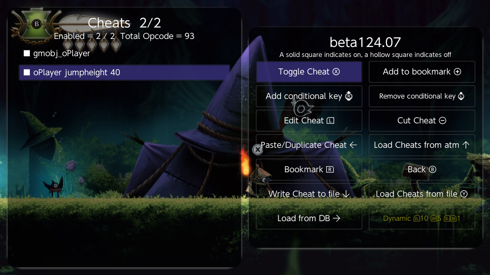

The player's `jumpheight` now reads 40, and writing 25 into it by hand is undone within half a second. Turn the variable's cheat off and it stays wherever it is put.

---

## Part 3: starting from a memory search (beta124.08)

Often a memory search finds the value before you know which object it belongs to. From beta124.08 that is enough.

Open the value in Memory Explorer and, with the cursor on it, press **Class field** (ZL+ZR+Y). Breeze finds the object that owns the value and opens its variables with the cursor on yours.

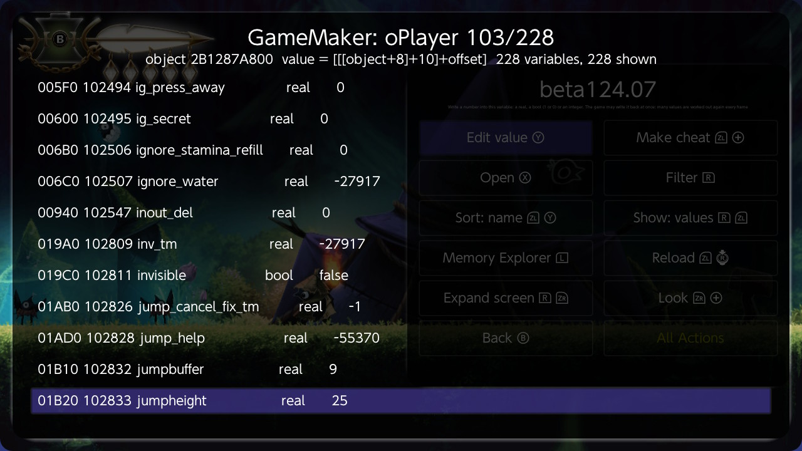

Here the value was the player's `jumpheight`. The title names the object, `oPlayer`, and **Make cheat** (ZL+Plus) continues exactly as in step 9.

A global variable opens at once. A variable of an object takes about five seconds, because Breeze looks through the game's memory for the owner; the screen stands still meanwhile.

---

## Good to know

- **The object's cheat holds the value on every instance of that object.** For the player there is one. For an enemy object it is every enemy of that kind, which is usually what you want.
- **Keep `gmobj_...` above the variable's cheat** in the list, and on. The variable's cheat only flips a switch inside it.
- **To change the value later**, edit the variable's cheat: the value is the two words before its last line, a 64-bit float. Or make the cheat again with a new value.
- **A second variable of the same object** joins the same `gmobj_` cheat. Press Add ASM on it again afterwards.
- **Saving in the cheat editor writes the game's cheat file** with the cheats that are loaded at that moment. If you keep other cheats for the game in that file, load them first (Load Cheats from file), or they are not in what gets written.
- **Some values will not stay.** The game works them out again every frame from another variable. On this game the player's walking speed is one: it is rebuilt from `walksp2`, so that is the one to hold.
- **Position and other built-in variables** (`x`, `y`, `sprite_index`) are not in the list. GameMaker keeps those differently.
- **Stop the watches when you are done.** Code watch and Watch methods change the game's code while they run; Stop puts it back.

## The numbers from this run

| | |
|---|---|
| Global variables | 1,233, of which 413 hold values |
| Events and scripts watched | 9,616 |
| Called while standing still | 145 |
| New after one attack | 12, in 3 lines: `o_attack` 8, scripts 3, `oPlayer` 1 |
| The player's variables | 228 |
| `jumpheight` | 25 before, held at 40 with the cheat on |
